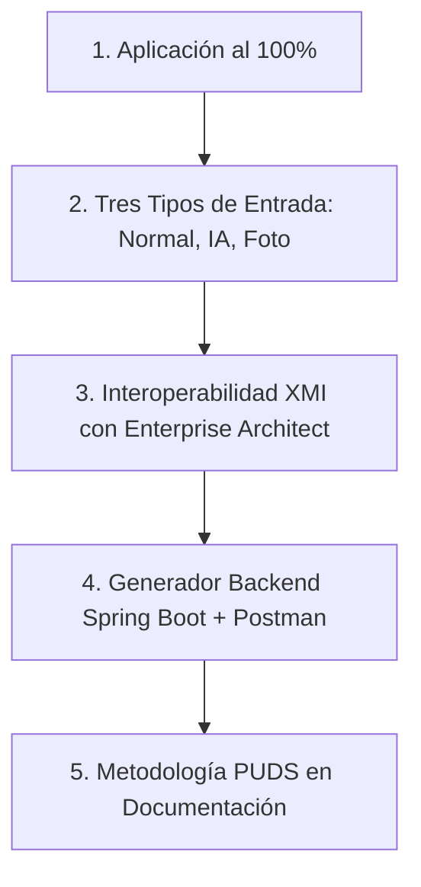

# 🎯 Guía Paso a Paso para la Demostración del Examen — SW1

**Proyecto:** Generador de Diagramas de Clases UML Colaborativo en Tiempo Real con Asistencia de IA, Generación de Backend Spring Boot y Cliente Móvil  
**Objetivo:** Demostrar el cumplimiento al 100% de las **5 preguntas de evaluación del docente** de forma fluida, ordenada y profesional.

---

## 📌 Enlaces Rápidos y Accesos Clave

* 🌐 **Plataforma Web en Producción:** [https://diagramasw1pracial100.duckdns.org](https://diagramasw1pracial100.duckdns.org)
* 💻 **Plataforma Web Local (Plan B):** `http://localhost:3000` (Backend en `http://localhost:8080`)
* 📱 **APK Móvil Release instalada en el celular:** [`ExamenSW1.apk`](file:///d:/Universidad/SW1S22026/ExamenSW1/ExamenSW1.apk) (~281 MB)
* 📄 **Documento Oficial PUDS:** [`docs/Documentacion_del_Proyecto.docx`](file:///d:/Universidad/SW1S22026/ExamenSW1/docs/Documentacion_del_Proyecto.docx)
* ⚡ **Script para abrir puerto de pruebas locales:** [`abrir_puerto_8085.bat`](file:///d:/Universidad/SW1S22026/ExamenSW1/abrir_puerto_8085.bat)

---

## 🧭 Flujo de Demostración de las 5 Preguntas



---

## 1️⃣ Pregunta 1: ¿La aplicación está completamente terminada en un 100% de acuerdo a lo solicitado?

### 🎯 Lo que evalúa el docente:
Que el sistema no sea una maqueta ni un prototipo a medias, sino una plataforma integral funcional (Web, Móvil, Backend, Nube, Base de Datos, Validaciones y Colaboración en vivo).

### 👣 Paso a Paso para Demostrarlo:

1. **Mostrar el despliegue en la Nube con SSL:**
   * Abre Google Chrome e ingresa a: **`https://diagramasw1pracial100.duckdns.org`**
   * Señala la barra de direcciones: *"Profesor, el sistema está desplegado en un servidor VPS en producción, con reverse proxy Nginx y certificados criptográficos HTTPS/WSS (Let's Encrypt)."*
2. **Iniciar Sesión o Registro:**
   * Inicia sesión con tus credenciales de prueba o crea un usuario nuevo para mostrar que la autenticación con JWT (`backend/src/auth/`) y la persistencia en PostgreSQL están operativas.
3. **Mostrar la Colaboración Multiusuario en Tiempo Real:**
   * Abre una segunda ventana en **Modo Incógnito** (o pide a un compañero que entre al link desde su laptop, o abre la app móvil en tu celular).
   * Entra al mismo diagrama.
   * **Señala la barra superior:** Verás el badge de presencia (`toolbar__presence`) indicando **2 usuarios conectados en línea**.
   * Mueve una clase en la Ventana 1: muestra cómo en la Ventana 2 se mueve de forma síncrona en menos de 50 milisegundos por WebSockets.
4. **Demostrar el Control de Concurrencia (Bloqueo Pesimista):**
   * En la Ventana 1, haz clic sobre una clase para editarla.
   * En la Ventana 2, muestra cómo esa clase se deshabilita y muestra un candado con tu nombre: nadie puede sobreescribir tu trabajo mientras la estés modificando. Al terminar de editar, se libera automáticamente.
5. **Mostrar la App Móvil (Flutter):**
   * Muestra la pantalla de tu celular con la APK instalada (`ExamenSW1.apk`).
   * Explica que cuenta con arquitectura **Offline-First** (base de datos local SQLite): permite trabajar sin internet y sincronizar con el servidor central al recuperar la señal.

---

## 2️⃣ Pregunta 2: ¿Soporta por lo menos: Edición normal, Edición a través de la IA, Edición a través de imágenes o foto?

### 🎯 Lo que evalúa el docente:
La versatilidad de interacción con el lienzo UML. Tu sistema soporta **4 modalidades de entrada**:
1. Edición normal (mouse/teclado)
2. Edición asistida por IA (prompts)
3. Edición a través de foto/imagen (visión por computadora)
4. Comandos de voz (Speech-to-Text)

### 👣 Paso a Paso para Demostrarlo:

### Modo 2.1: Edición Normal (Lienzo Interactivo)
1. Haz clic en el botón **"+ Nueva Clase"** de la barra de herramientas.
2. Asígnale el nombre `Producto`.
3. Agrégale dos atributos: `nombre: string` y `precio: double`.
4. Elige la visibilidad (`+` público, `-` privado o `#` protegido).
5. Arrastra una flecha de relación desde otra clase (ej. `Pedido`) hacia `Producto`.
6. Selecciona el tipo de relación: **Asociación**, **Composición** o **Agregación**, y define la multiplicidad (`1`, `*`, `1..*`).
7. Presiona el botón de **Auto-Organizar (Dagre Layout)** para ver cómo el diagrama se acomoda solo de forma prolija.

### Modo 2.2: Edición a través de la Inteligencia Artificial
1. Abre el panel lateral derecho del **Asistente IA**.
2. Escribe una instrucción en lenguaje natural en la caja de texto. Por ejemplo:
   > *"Agrega la clase Categoria con atributo descripcion string y relaciona Producto con Categoria de 1 a muchos"*
3. Presiona **Enviar**:
   * La IA (Gemini) no borra tu diagrama; ejecuta **operaciones atómicas incrementales** (`create_class`, `add_attribute`, `create_relation`).
   * Observa cómo en 2 segundos la nueva clase `Categoria` y su relación aparecen directamente en el lienzo.

### Modo 2.3: Edición a través de Fotos o Imágenes (Visión OCR)
1. En la barra superior, haz clic en el botón con ícono de **Cámara / Foto** (`Subir Foto`).
2. Selecciona una imagen de un diagrama dibujado a mano en papel o en una pizarra (puedes tener una imagen de prueba lista en tu escritorio o tomarle foto a un cuaderno).
3. El sistema enviará la imagen en Base64 al endpoint `/ai/interpret-photo`.
4. El modelo multimodal analiza los trazos y cajas:
   * Extrae los nombres de las clases.
   * Lee los atributos escritos a mano.
   * Detecta las líneas de relación.
5. Los nodos reconocidos se dibujan automáticamente en el lienzo con sus coordenadas.

### Modo 2.4: Extra — Comandos de Voz (Speech-to-Text)
1. En el panel de IA, presiona el botón del **Micrófono**.
2. Di en voz clara: *"Crea una clase Factura con atributo total double"*.
3. Verás cómo el navegador (Web Speech API) o el celular transcriben tu voz y la IA ejecuta la orden en el lienzo.

---

## 3️⃣ Pregunta 3: ¿Permite importar y exportar diagramas de clase desde y hacia Enterprise Architect (EA)?

### 🎯 Lo que evalúa el docente:
La interoperabilidad estandarizada de la herramienta CASE con software de la industria mediante el estándar internacional **XMI 2.1 (OMG UML 2.1)**.

### 👣 Paso a Paso para Demostrarlo:

### A. Exportar hacia Enterprise Architect:
1. En la barra de herramientas superior, haz clic en el botón **"Exportar XMI"**.
2. El navegador descargará inmediatamente un archivo con extensión `.xmi` (ejemplo: `mi-diagrama.xmi`).
3. Abre el archivo descargado con el Bloc de Notas o VS Code y muéstrale al docente:
   * El encabezado formal del estándar:  
     `<xmi:XMI xmi:version="2.1" xmlns:uml="http://schema.omg.org/spec/UML/2.1">`
   * Los nodos `<packagedElement xmi:type="uml:Class" name="Producto">`.
   * Los atributos `<ownedAttribute name="precio">` con tipos primitivos UML.
   * Las asociaciones con extremos `ownedEnd` y multiplicidades.
4. Si tienes Enterprise Architect instalado en tu equipo:
   * Abre EA ➔ Crea un proyecto ➔ Menú `Package` ➔ `Import/Export` ➔ `Import Package from XMI`.
   * Selecciona el archivo `.xmi` generado y verás tu diagrama importado con sus clases y relaciones intactas.

### B. Importar desde Enterprise Architect:
1. En la barra superior de tu aplicación web, haz clic en **"Importar XMI"**.
2. Selecciona un archivo `.xmi` o `.xml` exportado previamente desde Enterprise Architect.
3. El analizador sintáctico (`backend/src/diagrams/xmi-import.util.ts`) procesa el árbol XML y reconstruye el diagrama en el lienzo con nombres, atributos, métodos y asociaciones en menos de 1 segundo.

---

## 4️⃣ Pregunta 4: ¿Genera el backend completo para cualquier sistema de gestión empresarial a partir de un diagrama con por lo menos las 4 operaciones CRUD listos para probarse en Postman?

### 🎯 Lo que evalúa el docente:
Que la herramienta CASE no genere simples plantillas de texto vacías, sino un microservicio ejecutable de nivel empresarial con persistencia real.

### 👣 Paso a Paso para Demostrarlo:

1. **Generar el Código:**
   * Con tu diagrama en pantalla (ejemplo: `Cliente`, `Mesa`, `Pedido`, `Producto`), haz clic en el botón verde **"Generar Backend"** o **"Generar Código"**.
   * El sistema procesa el grafo y descargará un archivo comprimido: **`mi-diagrama.zip`**.
2. **Mostrar la Arquitectura Limpia de 4 Capas en Java Spring Boot:**
   * Extrae el ZIP y abre la carpeta generada con tu editor de código:
     ```text
     mi-diagrama/
     ├── pom.xml                                 # Java 17 + Spring Boot 3.3.4 + JPA + Postgres
     ├── Dockerfile                              # Multi-stage build
     ├── docker-compose.yml                      # App + Base de Datos PostgreSQL 16
     ├── README.md                               # Catálogo de endpoints y guía de uso
     ├── postman_collection.json                 # Colección Postman v2.1 autogenerada
     └── src/main/
         ├── resources/
         │   ├── application.properties          # Configuración JDBC
         │   └── schema.sql                      # Tablas DDL y llaves foráneas automáticas
         └── java/com/example/midiagrama/
             ├── entity/Cliente.java             # Capa 1: Entidad JPA (@Entity, @Table, @Column)
             ├── repository/ClienteRepository.java# Capa 2: Repositorio (JpaRepository)
             ├── service/ClienteService.java     # Capa 3: Servicio (@Service, @Transactional)
             ├── controller/ClienteController.java# Capa 4: Controlador REST (@RestController)
             └── config/OpenAPIConfig.java       # Documentación Swagger UI
     ```
3. **Verificar las 4 Operaciones CRUD:**
   * Abre `ClienteController.java` y muéstrale los 5 endpoints generados por entidad:
     * `POST /api/clientes` ➔ **Create (Crear)**
     * `GET /api/clientes/{id}` ➔ **Read (Buscar por ID)**
     * `GET /api/clientes` ➔ **Read (Listar todos)**
     * `PUT /api/clientes/{id}` ➔ **Update (Actualizar)**
     * `DELETE /api/clientes/{id}` ➔ **Delete (Eliminar)**
4. **Demostración en Postman (Listo para probar):**
   * Abre la aplicación **Postman**.
   * Haz clic en **Import** ➔ Selecciona el archivo **`postman_collection.json`** que vino dentro del ZIP (o que descargaste desde la web).
   * Verás todas las carpetas organizadas por entidad con sus peticiones `GET`, `POST`, `PUT`, `DELETE` y con **cuerpos JSON de prueba predefinidos**.
5. **Verificar Documentación Swagger UI y Docker:**
   * Explica que el proyecto incluye `docker-compose.yml`: con ejecutar `docker compose up -d`, la base de datos PostgreSQL y la aplicación arrancan solas y la documentación interactiva queda disponible en:  
     `http://localhost:8080/swagger-ui.html`

---

## 5️⃣ Pregunta 5: ¿Fue desarrollada en un 100% cumpliendo el PUDS registrado en la documentación entregada?

### 🎯 Lo que evalúa el docente:
El rigor metodológico de ingeniería de software. No basta con programar; hay que demostrar que se siguió el **Proceso Unificado de Desarrollo de Software (PUDS)** sin desviarse hacia otras metodologías.

### 👣 Paso a Paso para Defenderlo:

1. **Mostrar el Documento Oficial:**
   * Abre el archivo de documentación formal: [`docs/Documentacion_del_Proyecto.docx`](file:///d:/Universidad/SW1S22026/ExamenSW1/docs/Documentacion_del_Proyecto.docx) (1.58 MB).
2. **Explicar los 3 Pilares del PUDS:**
   * *"Profesor, el proyecto fue desarrollado bajo los 3 principios fundamentales del PUDS definidos por Jacobson, Booch y Rumbaugh:"*
     1. **Dirigido por Casos de Uso:** Los requisitos funcionales y los diagramas de casos de uso guiaron el diseño de los componentes y las pruebas.
     2. **Centrado en la Arquitectura:** Se diseñó bajo las **4+1 Vistas de Kruchten** (Vista Lógica con diagramas de clases, Vista de Componentes, Vista de Despliegue con Docker y Vista de Casos de Uso).
     3. **Iterativo e Incremental:** El software no se hizo en cascada; creció entrega tras entrega mitigando los riesgos técnicos mayores primero.
3. **Demostrar las 4 Fases del PUDS en tu Proyecto:**
   * **Fase de Inicio:** Delimitación del alcance, identificación de casos de uso críticos (modelado UML y generación de código) y evaluación de riesgos técnicos.
   * **Fase de Elaboración:** Definición de la línea base de la arquitectura (NestJS, React Flow, WebSockets, Spring Boot Generator y PostgreSQL en Docker).
   * **Fase de Construcción:** Desarrollo de las iteraciones completas (módulo de IA multimodal, cliente móvil en Flutter, persistencia de diagramas, interoperabilidad XMI).
   * **Fase de Transición:** Despliegue en el servidor de producción con SSL, pruebas de integración extremo a extremo con el cliente móvil y generación de manuales.
4. **Destacar la Regla de Oro ante el Docente:**
   * Si el docente te pregunta: *¿Usaron Scrum o historias de usuario ágiles?*
   * **Tu respuesta categórica:**  
     > *"No usamos Scrum, profesor. Siguiendo estrictamente sus indicaciones, este proyecto fue concebido, gestionado y documentado **100% bajo el Proceso Unificado de Desarrollo de Software (PUDS)**, utilizando sus fases, sus flujos de trabajo de ingeniería (Requisitos, Análisis, Diseño, Implementación y Pruebas) y sus artefactos formales."*

---

## ⏱️ Guion Rápido de Defensa (Speech de 2 Minutos)

Si el docente te dice: *"Tienes 2 minutos, muéstrame lo que hace tu sistema"*, di esto:

> *"Buenos días profesor. Nuestro proyecto es una **Herramienta CASE Colaborativa en la Nube con Asistencia de Inteligencia Artificial**.
>
> 1. **Completitud y Nube:** Está desplegada en producción en `https://diagramasw1pracial100.duckdns.org` con SSL y cuenta con un cliente móvil Android en Flutter con sincronización offline.
> 2. **Multiplicidad de Entradas:** Permite modelar mediante **edición visual directa**, mediante **asistente de IA** con lenguaje natural, mediante **fotografías de pizarras o papel** gracias a su motor de visión OCR, y por **comandos de voz**.
> 3. **Interoperabilidad:** Cumple con el estándar **XMI 2.1**, permitiendo importar y exportar diagramas completos hacia y desde **Enterprise Architect**.
> 4. **Generación de Software:** Transforma cualquier diagrama en un **backend empresarial completo en Spring Boot 3 y PostgreSQL** en 4 capas limpias (Entity, Repository, Service, Controller), empaquetado en Docker y con su **colección de Postman lista para ser probada**.
> 5. **Metodología:** Todo el ciclo de vida fue ejecutado y documentado estrictamente bajo el **Proceso Unificado de Desarrollo de Software (PUDS)**."*

---

## ✅ Checklist Final antes de Defender

- [ ] Servidor en la nube activo: Verificar en el navegador [https://diagramasw1pracial100.duckdns.org](https://diagramasw1pracial100.duckdns.org).
- [ ] Celular con la APK instalada (`ExamenSW1.apk`) y batería cargada.
- [ ] Tener una foto o boceto de diagrama a mano para la prueba de visión OCR.
- [ ] Tener Postman instalado en la laptop para importar `postman_collection.json`.
- [ ] Tener abierto el documento [`docs/Documentacion_del_Proyecto.docx`](file:///d:/Universidad/SW1S22026/ExamenSW1/docs/Documentacion_del_Proyecto.docx).
