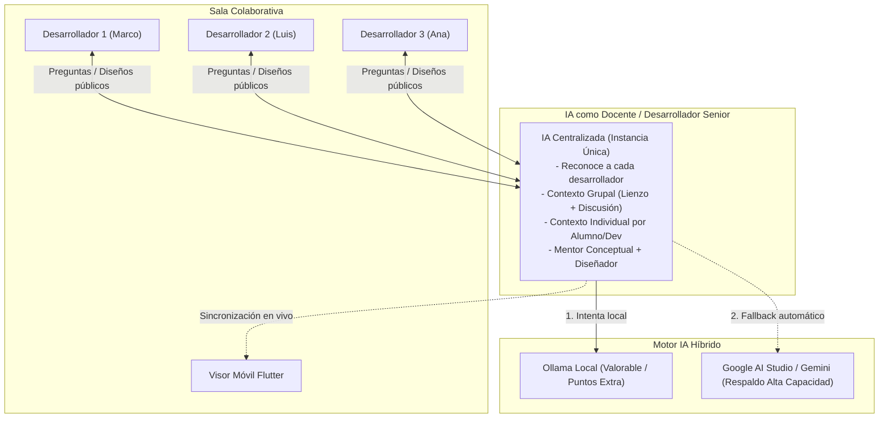
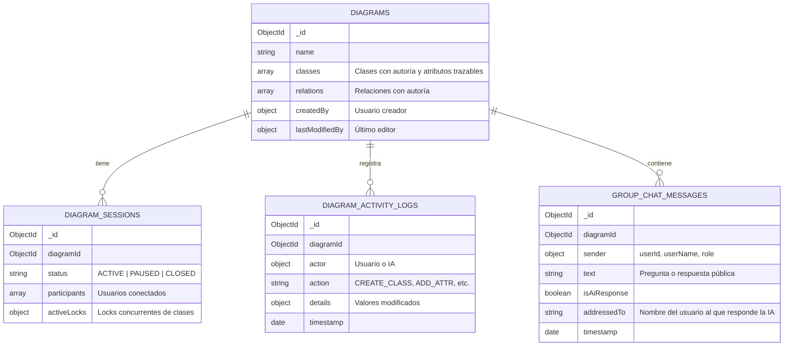

# 🎓 Plan Maestro de Evolución — 2do Examen Parcial (SW1)

**Proyecto:** Generador de Diagramas de Clases UML Colaborativo y Generador de Backend  
**Fecha de Entrega Oficial:** **Miércoles 11 de Noviembre de 2026 (4 semanas)**  
**Estrategia Elegida:** **Camino 2** — Evolución y extensión sobre la base 100% funcional del 1er Parcial.  
**Metáfora Central:** **"El Docente en el Aula / Desarrollador Senior Grupal"** (Instancia única, sabe quién pregunta, mentor teórico y ejecutor de diseño).  

---

## 📌 1. Requerimientos Oficiales (Basados en Apuntes de Clase)



### Tabla de Requerimientos Clave:
| # | Requerimiento de Clase | Cómo se implementa en el sistema |
|---|---|---|
| **R1** | **Evolución del 1er Parcial (Camino 2)** | Todo lo del 1er parcial sigue operativo (generador Spring Boot 3.3.4, voz, exportación XMI, locks pesimistas, etc.). |
| **R2** | **IA como Desarrollador Senior / Docente** | Instancia única en sala de WebSocket. Sin chats privados. Todos los usuarios ven preguntas y respuestas. La IA se dirige explícitamente a quien pregunta (*"Marco, ..."*). |
| **R3** | **Contexto Dual (Grupal e Individual)** | **Grupal:** El estado del diagrama y lo que todos van haciendo.<br/>**Individual:** La IA recuerda el hilo de dudas previas de cada usuario. |
| **R4** | **Capacidad de Mentor Teórico + Diseñador** | **Teoría:** Responde dudas de ingeniería de software (ej. "¿qué es un atributo derivado? dame un ejemplo").<br/>**Diseño:** Si se le solicita, entrega soluciones y modifica el tablero. |
| **R5** | **Modelo Híbrido (Local valorable + Cloud)** | **Ollama local** (qwen2.5) para sumar la valoración especial de modelo local, con fallback imperceptible a **Google AI Studio (Gemini)**. |
| **R6** | **Persistencia NoSQL (MongoDB)** | Sesiones continuas (recuperar el trabajo en días distintos), autoría por clase/atributo/relación y bitácora grupal. |
| **R7** | **App Móvil Flutter (Visor + Push)** | Modo solo lectura para ver cambios en vivo + notificaciones push cuando se actualice el diseño. |

---

## 🧠 2. Comportamiento de la IA: "El Docente en el Aula"

### 2.1. Reglas de Interacción de la IA:
1. **Nombrar siempre al interlocutor:** Al responder, la IA inicia dirigiéndose al usuario que hizo la consulta:
   > *"Marco, respondiendo a tu duda: un atributo derivado en UML es aquel cuyo valor se calcula a partir de otros atributos (se representa con una barra `/` antes del nombre, por ejemplo `/edad` calculada desde `fechaNacimiento`)."*
2. **Conciencia situacional del lienzo:** Sabe qué usuario creó cada clase y atributo. Si alguien pregunta *"¿Quién hizo la clase Pedido y qué le falta?"*, la IA responde:
   > *"Luis, la clase Pedido fue creada por Marco a las 10:15. Actualmente tiene los atributos `id` y `total`, pero le faltaría asociar la fecha y el estado del pedido."*
3. **Supervisión de cambios en el lienzo:** La IA solo emite operaciones de cambio al diagrama cuando el usuario lo pide explícitamente (ej: *"agrega ese atributo derivado a la clase"* o *"crea la relación entre Cliente y Factura"*).

---

## 🗄️ 3. Estructura de Persistencia NoSQL (MongoDB)

Para garantizar **sesiones continuas** y **autoría granular**, estructuraremos las siguientes colecciones:



---

## 📡 4. Protocolo de WebSockets Grupal (Salas y Contexto)

* **Canal:** `diagram:{diagramId}`
* **Eventos Principales:**
  1. `chat:send-message`: Cliente envía `{ text, diagramId }`.
  2. `chat:broadcast-message`: Servidor retransmite a toda la sala pública.
  3. `ai:status`: Notifica `{ isThinking: true, targetUser: "Marco" }`.
  4. `ai:respond`: La IA emite su respuesta nombrando a quien preguntó. Si generó cambios, emite también `diagram:apply-operations`.
  5. `diagram:sync`: Sincronización en tiempo real del lienzo (para clientes Web y Móvil Flutter).

---

## 🗓️ 5. Cronograma de Trabajo — 4 Semanas (Meta: 11 de Noviembre)

```
[Semana 1: 17 al 23 Oct] ──> Fase 1: MongoDB & Trazabilidad de Autoría
[Semana 2: 24 al 30 Oct] ──> Fase 2: Motor IA Híbrido (Ollama + Google AI Studio)
[Semana 3: 31 Oct al 6 Nov] ──> Fase 3: WebSocket Grupal ("Docente en el Aula") & UI Web
[Semana 4: 7 al 11 Nov]  ──> Fase 4: App Flutter (Visor Realtime + Push) & Simulacro Final
```

### Semana 1 (17 al 23 Octubre): Persistencia NoSQL y Sesiones Continuas
- [ ] Configurar MongoDB con `@nestjs/mongoose`.
- [ ] Modelar esquemas de `Diagram` con autoría granular (clase, atributo, relación).
- [ ] Implementar guardado de `DiagramSession` (reanudar el trabajo de días anteriores).
- [ ] Implementar `DiagramActivityLog` (bitácora de qué hizo cada integrante).

### Semana 2 (24 al 30 Octubre): Motor IA Híbrido (Local + Google AI Studio)
- [ ] Construir `HybridAiProvider`:
  - Intento prioritario en **Ollama local** (modelo `qwen2.5:1.5b-instruct` o `llama3.2`).
  - Fallback automático e imperceptible a **Google AI Studio (Gemini 3.6 Flash)**.
- [ ] Diseñar el System Prompt del "Docente / Moderador Senior":
  - Identificación del usuario por nombre.
  - Memoria del contexto grupal y seguimiento a dudas individuales.
  - Capacidad de mentor teórico (definiciones, ejemplos) y diseñador práctico.

### Semana 3 (31 Octubre al 6 Noviembre): Sincronización Grupal y Frontend Web
- [ ] Actualizar [`diagrams.gateway.ts`](file:///d:/Universidad/SW1S22026/ExamenSW1/backend/src/diagrams/diagrams.gateway.ts) para manejar el chat grupal público con la IA.
- [ ] Adaptar [`ChatPanel.tsx`](file:///d:/Universidad/SW1S22026/ExamenSW1/frontend/src/components/ChatPanel.tsx):
  - Vista grupal: ver avatar/nombre de quién escribe y respuestas dirigidas de la IA.
  - Soporte de dictado por voz para enviar consultas al docente IA.
- [ ] Mostrar autoría en el lienzo ([`ClassInspector.tsx`](file:///d:/Universidad/SW1S22026/ExamenSW1/frontend/src/components/ClassInspector.tsx)) indicando quién creó y editó cada clase o atributo.

### Semana 4 (7 al 11 Noviembre): Móvil Flutter, Notificaciones y Pruebas
- [ ] Conectar la app Flutter en modo **visor en tiempo real** mediante WebSockets.
- [ ] Implementar notificaciones en el celular ante cambios del diagrama o intervenciones de la IA.
- [ ] Simulacro end-to-end con 3 usuarios conectados simultáneamente y defensa de prueba.

---

## ⚡ Comandos Rápidos de Trabajo

```bash
# Iniciar MongoDB en Docker
docker run -d --name mongodb-sw1 -p 27017:27017 -v mongodb_data:/data/db mongo:7.0

# Verificar Ollama local
curl http://localhost:11434/api/tags

# Descargar modelo recomendado para pruebas locales
ollama pull qwen2.5:1.5b-instruct

# Ejecutar Backend NestJS
cd backend && npm run start:dev

# Ejecutar Frontend React
cd frontend && npm run dev
```
