**Documentación del Proyecto**

*Herramienta CASE web para modelado de diagramas de clases UML 2.5+ y generación automática de backends Spring Boot*

Materia: Ingeniería de Software 1

Formato de citación: Normas APA (7.ª edición)

**PARTE 1 --- Fundamentación del Proyecto**

# 2. Fundamentación teórica

## 2.1. Ingeniería de Software Asistida por Computadora (CASE)

La Ingeniería de Software Asistida por Computadora (CASE, por sus siglas en inglés) es el conjunto de herramientas que apoyan el trabajo de análisis, diseño, construcción y mantenimiento de software. Automatizan tareas repetitivas, verifican consistencia y generan artefactos ---diagramas, código, documentación--- a partir de modelos (Pressman & Maxim, 2015).

### 2.1.1 Funciones básicas de las herramientas CASE

- **Acelerar el desarrollo** evitando codificación manual innecesaria.

- **Estandarizar** nombres, capas y patrones (entidad → repositorio → servicio → controlador).

- **Reducir errores** con validaciones y plantillas.

- **Mantener trazabilidad** entre requerimientos, modelos y código.

- **Facilitar cambios**: si cambia el modelo, se regenera el código afectado.

### 2.1.2 Clasificación de herramientas CASE

- **Upper-CASE:** ayudan en fases tempranas (requerimientos, análisis, diseño).

- **Lower-CASE:** ayudan en construcción, pruebas y mantenimiento (generación de código, refactor).

- **Integradas:** cubren de punta a punta y conectan modelos con código.

El proyecto desarrollado corresponde a una herramienta CASE integrada: el mismo lienzo donde el usuario modela el diagrama de clases alimenta directamente al motor que genera el código del backend, sin pasos manuales intermedios.

### 2.1.3 Ventajas y desventajas

- **Ventajas:** productividad, estandarización del código generado, reducción de errores, documentación automática (exportación XMI).

- **Desventajas:** curva de aprendizaje de la herramienta, rigidez del código generado frente a plantillas, y dependencia tecnológica del framework de salida (en este caso, Spring Boot).

## 2.2. Desarrollo de Software Basado en Componentes (CBSE)

La Ingeniería de Software Basada en Componentes (CBSE) es un enfoque de desarrollo que construye aplicaciones a partir de componentes reutilizables e independientes, cada uno con una interfaz bien definida que expone qué hace sin exponer cómo lo hace (Szyperski, 2002). El principio central es definir primero qué se necesita, y luego ensamblar y reutilizar librerías y módulos ya existentes que aceleren la productividad, en lugar de construir todo desde cero.

Este principio se aplicó de dos formas concretas en el proyecto:

- **Reutilización de componentes de terceros:** en vez de construir un motor de lienzo interactivo desde cero, se ensambló la librería React Flow para el modelado visual; TypeORM para la persistencia; Socket.io para la colaboración en tiempo real; y el SDK oficial de Google Gemini para la integración de IA. Cada una es un componente independiente, con una interfaz clara, integrado sin modificar su código interno.

- **Producción de componentes propios reutilizables:** el motor generador no escribe cada archivo Java a mano; produce cada uno de los cuatro artefactos (Entity, Repository, Service, Controller) a partir de la MISMA plantilla parametrizada, aplicada una vez por cada clase del diagrama. Esa plantilla es, en sí misma, un componente de software reutilizado tantas veces como clases tenga el modelo del usuario --- exactamente el principio de \"producir componentes que se usen varias veces\".

Los beneficios observados coinciden con los descritos en la literatura: reducción de costos y tiempo de desarrollo al no construir cada pieza desde cero, escalabilidad (agregar un nuevo tipo de relación no obliga a reescribir el motor completo), y mantenibilidad, dado que una corrección en una plantilla se propaga automáticamente a todo el código futuro generado.

## 2.3. El Software como Producto

No cualquier software desarrollado puede llamarse, en sentido estricto, un "producto". Un producto de software es aquel que ha superado la etapa de desarrollo interno y se ofrece ---implícita o explícitamente--- a un mercado que lo evalúa, lo compara con alternativas existentes y decide si le genera valor suficiente para adoptarlo (Pressman & Maxim, 2015). Esta distinción importa porque cambia el estándar de calidad exigido: un software que solo debe funcionar para el propio equipo que lo construyó se evalúa de forma muy distinta a uno que debe sostenerse frente al juicio de terceros.

### 2.3.1 Terminado, probado y con garantía

La primera condición es que el software esté completo: no un prototipo ni un producto mínimo viable (MVP), sino una versión que un tercero pueda usar sin que el equipo de desarrollo deba intervenir constantemente para que funcione. Un MVP, por definición, es una versión deliberadamente incompleta construida para validar una hipótesis con el menor esfuerzo posible (Ries, 2011): es una herramienta de aprendizaje, no un producto terminado. Un producto de software, en cambio, ha sido probado lo suficiente como para que el equipo esté dispuesto a respaldarlo con una garantía ---la garantía es, en la práctica, la señal de que el desarrollador confía en que el software funcionará según lo prometido, y no solo "la mayoría de las veces" bajo condiciones controladas.

### 2.3.2 Validado por el mercado, no solo por el cliente

La segunda condición es que el software resuelva una necesidad validada por un mercado, no únicamente por el cliente puntual que lo encargó. Un desarrollo a medida puede satisfacer a un solo cliente sin que eso lo convierta en un producto; un producto, en cambio, debe demostrar que resuelve un problema compartido por un conjunto más amplio de usuarios potenciales. Es ese mercado ---no el equipo que lo construyó ni un único comprador--- quien finalmente juzga si el software tiene valor real.

### 2.3.3 Diferenciación: el sello que distingue al producto

La tercera condición reconoce que casi siempre existirá software similar compitiendo por la misma necesidad. Por eso un producto necesita una diferenciación deliberada ---una marca, una característica distintiva o una combinación de decisiones de diseño--- que lo posicione como superior a las alternativas existentes para el segmento de mercado que busca atender, en lugar de competir únicamente por ser "una opción más".

### 2.3.4 Aplicación al proyecto

Aplicando este marco a la herramienta desarrollada, el diferencial que se busca (el "sello") es la integración de capacidades que, por separado, sí existen en el mercado ---canvas de modelado UML colaborativo por un lado, generadores de código a partir de modelos por otro--- pero que rara vez conviven en una misma herramienta con foco explícito en la generación de un backend completo, validación lógica automática del modelo y un asistente de IA que edita el diagrama por operaciones puntuales en vez de regenerarlo. En cuanto a estar "terminado, probado y con garantía" en el sentido estricto aquí definido, el proyecto se ubica todavía en la etapa de prototipo funcional verificado técnicamente, no en la de un producto listo para el mercado ---una distinción relevante para no sobreestimar su madurez actual frente a la definición desarrollada en esta sección.

## 2.4. Ingeniería Humana (Experiencia del Usuario --- UX)

La Experiencia de Usuario (UX) se centra en cómo las personas interactúan con un sistema, evaluando facilidad de uso, accesibilidad, eficiencia, satisfacción y consistencia. Según la norma ISO 9241-210, la UX es "la respuesta de una persona que resulta del uso o la anticipación del uso de un producto, sistema o servicio". En una herramienta CASE, donde el usuario pasa la mayor parte del tiempo manipulando un modelo visual, estos principios no son un añadido cosmético: determinan directamente qué tan rápido alguien puede pasar de una idea a un diagrama correcto.

Aplicación al proyecto:

- **Facilidad de uso y curva de aprendizaje:** un recorrido guiado interactivo (tour paso a paso) introduce cada función del lienzo la primera vez que se usa la herramienta, y una leyenda de notación UML permanente en el propio lienzo recuerda el significado de cada símbolo (triángulo hueco, rombos, línea punteada) sin obligar al usuario a salir de la aplicación para consultarlo.

- **Retroalimentación inmediata:** la validación lógica del modelo, el deshacer/rehacer, y el bloqueo visual de una clase que otro usuario está editando en ese momento le devuelven al usuario el estado del sistema sin que tenga que adivinarlo.

- **Reducción de carga cognitiva:** la barra de herramientas agrupa las acciones por función (edición, archivo, herramientas) en lugar de exponer una fila plana de botones sueltos, y las acciones menos frecuentes (importar, exportar, documentación, bitácora) se recogen en un menú desplegable "Archivo" en vez de competir visualmente con las acciones de uso constante.

- **Consistencia:** la misma semántica de multiplicidad y estereotipo se respeta en tres representaciones distintas del mismo modelo --- el lienzo interactivo, el archivo XMI exportado y el código Java generado --- evitando que el usuario tenga que reconciliar información contradictoria entre ellas.

# 3. Arquitectura de software

## 3.1. Propósito y estilos de la arquitectura de software

La arquitectura de software es el diseño estructural de un sistema: define cómo se organizan sus componentes y cómo interactúan entre sí (Fowler, 2002). Su propósito último, tal como lo plantea Martin (2017), no es meramente técnico sino de supervivencia del propio sistema: una buena arquitectura busca que el software viva el mayor tiempo posible, minimizando el costo humano de construirlo y ---sobre todo--- de mantenerlo y modificarlo a lo largo de los años. Cuánto tiempo \"vive\" un software depende directamente de su estructura: un sistema con acoplamiento bajo y responsabilidades bien separadas puede evolucionar durante años sin reescrituras completas; uno con una estructura rígida se vuelve, tarde o temprano, más caro de mantener que de reemplazar.

### 3.1.1 Estilos de arquitectura aplicados en el proyecto

- **Arquitectura en capas:** tanto el backend propio de la herramienta como cada backend Spring Boot generado siguen una separación estricta Controlador → Servicio → Repositorio → Entidad, con responsabilidades no solapadas entre capas.

- **Cliente-servidor:** el lienzo web (cliente) se comunica con el backend NestJS (servidor) vía REST y WebSockets.

- **Arquitectura basada en eventos:** la colaboración en tiempo real entre varios usuarios editando el mismo diagrama se resuelve mediante eventos emitidos y consumidos sobre WebSockets (Socket.io), no mediante sondeo (polling).

## 3.2. Transformación y diseño de datos

La transformación y diseño de datos define cómo la información se representa, organiza y manipula a lo largo de las tres etapas clásicas del diseño de bases de datos: conceptual, lógico y físico.

- **Diseño conceptual:** el diagrama de clases UML que el usuario dibuja en el lienzo (clases, atributos tipados, relaciones).

- **Diseño lógico:** la resolución automática de cada relación UML a su forma JPA equivalente (uno a uno, uno a muchos, muchos a uno, muchos a muchos), determinando el lado propietario y el lado inverso de cada relación bidireccional.

- **Diseño físico:** la generación de tablas, columnas, claves foráneas y tablas intermedias en PostgreSQL a partir de las anotaciones JPA producidas.

En este proyecto, la transformación de datos es el núcleo mismo de la herramienta: el motor generador convierte cada clase UML en una entidad JPA anotada (@Entity, \@Id, \@OneToMany, \@ManyToOne, \@ManyToMany), infiriendo automáticamente el tipo de columna, la visibilidad de los atributos y la multiplicidad de cada relación, sin que el usuario escriba una sola línea de SQL.

# 4. Modelado UML 2.5+

## 4.1. Fundamentos y origen de UML

El Lenguaje Unificado de Modelado (UML) es el estándar internacional para el modelado de sistemas de software. Su origen se remonta a la unificación de tres metodologías de modelado orientado a objetos que competían entre sí a inicios de los años noventa: la Técnica de Modelado de Objetos ---OMT, Object Modeling Technique--- de James Rumbaugh, el método de Grady Booch, y la técnica de Ingeniería de Software Orientada a Objetos ---OOSE--- de Ivar Jacobson (Rumbaugh, Jacobson, & Booch, 2005). Los tres autores, conocidos posteriormente como \"los tres amigos\", unieron sus notaciones en un único lenguaje formalizado y estandarizado por el Object Management Group (OMG), cuya especificación vigente se publica y mantiene en omg.org (Object Management Group, 2017).

### 4.1.1 Objetivos de UML 2.5

- Proporcionar un lenguaje de modelado estándar, expresivo y preciso.

- Facilitar el intercambio de modelos entre herramientas y equipos de desarrollo.

- Soportar el ciclo de vida completo del software, desde el análisis hasta la implementación.

### 4.1.2 Principales artefactos de UML 2.5

Diagramas estructurales: Clases, Componentes, Despliegue, Paquetes.

Diagramas de comportamiento: Casos de Uso, Secuencia, Comunicación, Actividad, Estado.

## 4.2. Del modelo orientado a objetos al modelo relacional: el porqué del mapeo

El proyecto se centra específicamente en el diagrama de clases, el artefacto estructural que describe la organización estática del sistema ---clases, atributos y relaciones---, y en su transformación automática hacia un modelo relacional. Este paso no es trivial: existe una diferencia estructural conocida como el \"desajuste de impedancia objeto-relacional\" (object-relational impedance mismatch) entre el paradigma orientado a objetos y el modelo relacional (Fowler, 2002). Un objeto puede tener herencia, referencias directas a otros objetos y colecciones anidadas; una tabla relacional solo puede representar filas planas relacionadas por claves foráneas.

Por eso se mapea de POO a modelo relacional: cada clase se convierte en una tabla, cada atributo en una columna, y cada relación de objetos (asociación, agregación, composición, herencia) debe traducirse a un mecanismo puramente relacional ---clave foránea para las relaciones de uno a muchos, tabla intermedia para las de muchos a muchos, o una tabla adicional para la herencia---. Este es precisamente el problema que resuelve el motor generador del proyecto: automatiza esa traducción, que de hacerse a mano es repetitiva y propensa a errores.

## 4.3. Notación UML 2.5+ utilizada en el proyecto

El usuario construye el diagrama de clases de forma interactiva sobre el lienzo, definiendo:

- **Clases:** con nombre y atributos tipados (nombre, tipo de dato, visibilidad, y marca de clave primaria).

- **Relaciones:** asociación, agregación, composición, herencia, y las cuatro multiplicidades relacionales (uno a uno, uno a muchos, muchos a uno, muchos a muchos).

El modelo resultante se exporta en formato estándar XMI 2.1 / UML 2.1 ---el mismo formato de intercambio que reconocen herramientas profesionales como Enterprise Architect---, preservando clases, atributos tipados, visibilidad, multiplicidad de cada asociación y generalizaciones entre clases.

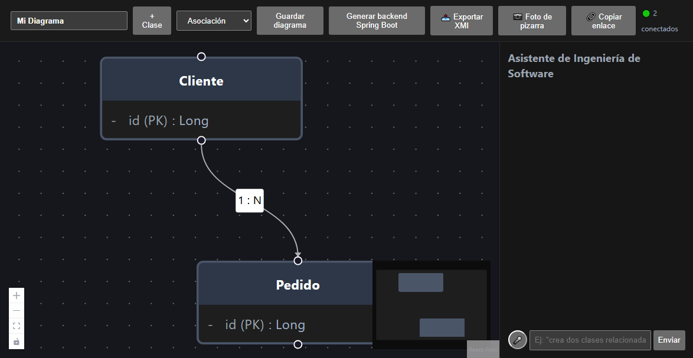{width="5.833333333333333in" height="3.0208333333333335in"}

*Anexo A.1 --- Captura real del sistema en ejecución: lienzo con las clases Cliente y Pedido conectadas por una relación 1:N. El indicador \"1 conectado\" (esquina superior derecha) confirma la sesión de colaboración en tiempo real activa.*

# 5. La Inteligencia Artificial en el desarrollo de software

El sistema integra inteligencia artificial directamente dentro del backend de la herramienta CASE, mediante la API de Google Gemini, con el objetivo de aumentar la productividad del usuario durante el modelado. La IA se aplica en tres canales multimodales complementarios: chat conversacional en texto, comandos de voz capturados por el navegador, e interpretación visual de fotografías de diagramas dibujados a mano.

### 5.1 Personalización del modelo

El modelo de lenguaje no se usa de forma genérica: se le personaliza mediante instrucciones de sistema distintas según la tarea. Para el chat, se le restringe (\"enjaula\") a responder exclusivamente sobre ingeniería de software y modelado UML; para la interpretación de imágenes, se le instruye explícitamente sobre cómo inferir el tipo de relación UML a partir de la notación dibujada a mano (flecha hueca, rombos, cardinalidades) y se le exige devolver una estructura JSON estricta y verificable por el backend.

### 5.2 Funciones de IA implementadas

- **Chat conversacional enjaulado:** responde exclusivamente sobre ingeniería de software y este proyecto, rechazando temas fuera de dominio.

- **Comandos de voz (Web Speech API):** el usuario dicta un comando (ej. \"crea dos clases relacionadas\") que se transcribe en el navegador y se envía al mismo canal de chat.

- **Interpretación de fotografías de pizarra:** un endpoint dedicado recibe una imagen, la envía a Gemini junto con las instrucciones de personalización descritas arriba, y devuelve un modelo estructurado (clases, atributos, relaciones) que se mezcla directamente en el lienzo del usuario.

Estas tres funciones comparten el mismo cliente de IA configurado en el backend, cada una invocada con su propio conjunto de instrucciones --- una forma ligera de especialización por tarea que podría evolucionar, en una futura iteración, hacia una arquitectura de agentes más explícitamente separados (uno de conversación, uno de visión, uno de manipulación directa del lienzo).

**Anexo A.2 --- Transcripción real de una consulta al asistente de IA**

**Usuario: ¿Qué es una relación de agregación en UML y cuándo debo usarla?**

- En el lenguaje de modelado UML, la agregación es un tipo de asociación especial que representa una relación de \"todo-parte\" (has-a) entre dos clases, donde el acoplamiento entre ellas es débil.

- Independencia de ciclo de vida: la \"parte\" puede existir de forma independiente al \"todo\". Si el objeto contenedor se destruye, los objetos contenidos siguen existiendo.

- Representación gráfica: se dibuja con una línea continua que une a las dos clases, con un rombo hueco en el extremo de la clase contenedora.

- Diferencia con la composición: en la composición (rombo lleno) el acoplamiento es fuerte y la parte no puede existir sin el todo (ej. Factura--DetalleFactura); en la agregación (rombo hueco) el acoplamiento es débil (ej. Departamento--Profesor).

- Traducción a Spring Boot/JPA: se suele mapear con \@OneToMany o \@ManyToMany sin cascade = CascadeType.REMOVE, garantizando que eliminar la entidad principal no borre las entidades asociadas.

*(Respuesta real generada por Google Gemini durante una sesión de pruebas del sistema; no editada.)*

# 6. Todo lo relacionado con Spring Boot

El principal artefacto de salida de la herramienta es un backend Spring Boot completo y compilable, generado automáticamente a partir del diagrama de clases, siguiendo la arquitectura en capas Controlador → Servicio → Repositorio → Entidad, con PostgreSQL como base de datos relacional.

### 6.1 Contenido generado por clase del diagrama

- **Entidad (Entity):** clase Java anotada con \@Entity, con sus atributos tipados y las relaciones resueltas como campos JPA en ambos extremos de cada relación bidireccional.

- **Repositorio (Repository):** interfaz que extiende JpaRepository, habilitando las operaciones CRUD estándar sin código adicional.

- **Servicio (Service):** clase con la lógica de negocio básica: buscar, guardar, actualizar y eliminar.

- **Controlador (Controller):** endpoints REST (GET, POST, PUT, DELETE), con soporte CORS habilitado (@CrossOrigin) para que cualquier frontend pueda consumirlos sin configuración adicional.

- **Configuración de serialización:** una clase adicional que resuelve dos problemas reales detectados durante el desarrollo --- la recursión infinita al serializar relaciones bidireccionales a JSON, y el error de serialización de los proxies perezosos de Hibernate --- mediante anotaciones \@JsonIgnoreProperties y el módulo Hibernate6Module.

### 6.2 Edición del backend generado y pruebas con Postman

El backend generado no es una caja negra: es un proyecto Maven estándar que el desarrollador puede abrir, editar y extender libremente después de generado ---agregar validaciones, reglas de negocio adicionales, seguridad, etc.--- sin perder la estructura de cuatro capas con la que fue creado.

Se validó el flujo completo de extremo a extremo: se generó un backend a partir de un diagrama de prueba, se compiló con Maven, se ejecutó localmente contra una base de datos PostgreSQL real, y se probó cada endpoint (crear, listar, actualizar, eliminar) mediante peticiones HTTP equivalentes a Postman. Esta verificación práctica permitió detectar y corregir en la propia plantilla generadora los dos problemas de serialización JSON mencionados en 6.1, garantizando que todo backend generado a partir de ese momento los tenga resueltos de forma permanente.

### 6.3 Librerías y dependencias utilizadas

El backend generado es un proyecto Maven estándar sobre Spring Boot 3.3.4 y Java 17, heredando la gestión de versiones del spring-boot-starter-parent (BOM que fija versiones compatibles entre todas las dependencias, evitando conflictos manuales). Cada librería incluida responde a una necesidad concreta de la arquitectura en cuatro capas; no se agregó ninguna dependencia superflua.

- **spring-boot-starter-web ---** expone la capa de controladores como una API REST. Incluye el servidor embebido Tomcat, el framework Spring MVC y la librería de serialización Jackson, permitiendo que el backend arranque de forma autónoma (java -jar) sin necesidad de desplegar en un servidor de aplicaciones externo.

- **spring-boot-starter-data-jpa ---** provee la capa de persistencia mediante JPA (Jakarta Persistence API) con Hibernate como implementación ORM. Es la librería que permite que cada \@Entity del diagrama se mapee automáticamente a una tabla, y que los repositorios (JpaRepository) ofrezcan las operaciones CRUD sin escribir SQL.

- **postgresql ---** driver JDBC de PostgreSQL. Es el puente entre Hibernate y la base de datos relacional; sin él, la aplicación no podría abrir conexiones al motor PostgreSQL configurado en application.properties.

- **spring-boot-starter-validation ---** integra Jakarta Bean Validation (Hibernate Validator). Habilita la validación declarativa de los datos que entran por los endpoints mediante anotaciones (@NotNull, \@Size, etc.), reforzando la integridad de la información antes de persistirla.

- **jackson-datatype-hibernate6 ---** módulo de Jackson que resuelve un problema real detectado durante el desarrollo: la serialización a JSON de los proxies perezosos (lazy) de Hibernate. Sin este módulo, exponer entidades con relaciones perezosas por la API provocaría errores de serialización. Se registra junto con \@JsonIgnoreProperties para evitar además la recursión infinita en relaciones bidireccionales.

- **springdoc-openapi-starter-webmvc-ui (versión 2.6.0) ---** genera de forma automática la especificación OpenAPI 3 de todos los controladores y sirve una interfaz Swagger UI navegable en /swagger-ui.html. Permite al evaluador (o a cualquier consumidor del backend) explorar y probar los endpoints desde el navegador sin herramientas externas, complementando las pruebas con Postman.

- **spring-boot-starter-test (ámbito test) ---** suite de pruebas que agrupa JUnit 5, Mockito, AssertJ y Spring Test. Queda disponible en el proyecto generado para que el desarrollador añada pruebas unitarias y de integración sobre la lógica de negocio de la capa de servicio.

- **spring-boot-maven-plugin (plugin de build) ---** empaqueta la aplicación como un JAR ejecutable auto-contenido (fat JAR) que incluye todas las dependencias y el servidor embebido, de modo que el backend se ejecuta con un único comando y es directamente contenedorizable con Docker.

En conjunto, estas dependencias materializan la arquitectura en capas Controlador → Servicio → Repositorio → Entidad descrita en 6.1: spring-boot-starter-web para la capa de exposición, spring-boot-starter-data-jpa y el driver postgresql para la persistencia, spring-boot-starter-validation y los módulos de Jackson para la integridad y correcta serialización de los datos, y springdoc-openapi para la documentación viva de la API. La selección se mantuvo deliberadamente mínima y estándar para que el backend generado sea fácil de entender, extender y defender.

### 6.4 Artefactos adicionales generados

Además del código Java de las cuatro capas, el proyecto generado incluye archivos que facilitan su prueba y despliegue inmediato:

- **postman_collection.json:** colección Postman v2.1 con todos los endpoints CRUD de cada clase, lista para importar en Postman y probar el backend sin configuración manual.

- **src/main/resources/schema.sql:** script DDL con la definición de todas las tablas y sus claves foráneas, compatible con PostgreSQL, H2 y MySQL (sintaxis ANSI).

- **src/main/resources/data.sql:** datos de prueba realistas, ordenados para respetar las claves foráneas (las entidades padre se insertan antes que las hijas), de modo que el sistema arranque con información de ejemplo.

Adicionalmente, la herramienta web permite exportar la colección Postman directamente desde el diagrama, sin necesidad de generar todo el proyecto, y ofrece una vista previa del código generado antes de la descarga.

# 7. El Proceso de Desarrollo de Software (PUDS)

El Proceso Unificado de Desarrollo de Software (PUDS) es un marco estructurado que organiza las actividades necesarias para construir un sistema, desde la captura de requisitos hasta la entrega y el mantenimiento del producto final. Su propósito es garantizar que el software cumpla los objetivos establecidos dentro de un tiempo y alcance definidos, reduciendo riesgos y ordenando la coordinación del equipo de trabajo.

## 7.1. Fases del PUDS

- **Análisis de requisitos:** identificación y documentación de las necesidades del usuario y del negocio.

- **Diseño del sistema:** definición de la arquitectura, los componentes y su integración.

- **Implementación:** traducción del diseño en código funcional.

- **Pruebas:** validación de que el sistema cumple los requisitos definidos.

- **Despliegue:** puesta en marcha del sistema en un entorno accesible para los usuarios finales.

- **Mantenimiento:** correcciones, adaptaciones y mejoras continuas una vez el sistema está en uso.

## 7.2. Metodologías dentro del PUDS

El PUDS es un marco de fases, no una metodología única: puede recorrerse con distintos enfoques de trabajo, entre ellos:

- **Modelo en cascada:** las fases se ejecutan de forma secuencial y estructurada, una después de la otra.

- **Metodologías ágiles (Kanban, XP):** promueven iteraciones cortas, entregas incrementales verificables y adaptación continua a cambios de requisitos.

- **Modelo incremental y evolutivo:** el software se construye en etapas sucesivas, cada una añadiendo funcionalidad sobre la anterior.

- **Proceso Unificado (UP):** desarrollo guiado por casos de uso, con énfasis en la gestión temprana de riesgos.

La Parte 2 de este documento desarrolla en detalle cómo se recorrieron las fases de análisis, diseño e implementación para este proyecto, siguiendo el marco de fases del PUDS de manera incremental a lo largo de varios ciclos de trabajo, en lugar de ejecutarlas una sola vez de forma estrictamente lineal.

**PARTE 2 --- Proceso de Desarrollo de Software (PUDS)**

# 1. Perfil

## 1.1. Introducción

El presente proyecto desarrolla una herramienta CASE web para el modelado colaborativo de diagramas de clases UML 2.5+ y la generación automática de backends Spring Boot. El caso de uso real es una empresa de desarrollo de software que necesita acelerar la construcción de sistemas de información con arquitectura en capas, evitando la codificación manual repetitiva de las capas Entity, Repository, Service y Controller a partir de un diagrama de clases ya validado por el equipo.

El sistema combina un lienzo de modelado colaborativo en tiempo real, un motor generador de código que transforma el modelo UML en un proyecto Spring Boot compilable, y un asistente de inteligencia artificial multimodal (texto, voz, imagen) que ayuda al usuario a construir el diagrama.

## 1.2 Descripción del problema

Los equipos de desarrollo dedican una parte significativa de su tiempo a escribir código repetitivo y mecánico: entidades JPA, repositorios, servicios CRUD y controladores REST que se derivan directamente de un diagrama de clases ya acordado. Este trabajo manual es propenso a errores de transcripción, inconsistente entre desarrolladores, y no deja un artefacto de diseño reutilizable una vez escrito el código. Además, cuando el modelado se hace en equipo, la falta de herramientas colaborativas en tiempo real obliga a los desarrolladores a coordinar cambios de forma asíncrona, generando conflictos y demoras.

## 1.3 Objetivo General

Desarrollar una herramienta CASE web que permita a un equipo de desarrollo modelar diagramas de clases UML de forma colaborativa y generar automáticamente un backend Spring Boot funcional y compilable a partir de ese modelo.

## 1.4 Objetivos Específicos

- Implementar un lienzo de modelado interactivo en React con la librería React Flow.

- Desarrollar un motor generador de código en NestJS que transforme el modelo UML en las cuatro capas de un proyecto Spring Boot.

- Integrar colaboración en tiempo real mediante WebSockets (Socket.io) para edición simultánea de diagramas.

- Conectar un asistente de inteligencia artificial (Google Gemini) para chat conversacional, dictado por voz e interpretación de fotografías de diagramas dibujados a mano.

- Implementar la importación y exportación del diagrama en formato estándar XMI 2.1 para interoperar con herramientas UML externas como Enterprise Architect.

- Incorporar autenticación de usuarios (registro e inicio de sesión) para identificar con nombre real a quien edita cada clase.

- Registrar una bitácora de cambios por diagrama que indique quién modificó qué y cuándo.

- Permitir adjuntar documentos e imágenes a un diagrama, respaldados en almacenamiento en la nube (Amazon S3).

- Soportar la declaración de clases abstractas e interfaces, reflejadas tanto en el diagrama como en el código Java generado.

- Habilitar la selección múltiple de clases y la exportación del diagrama como imagen (PNG/SVG).

- Desplegar la aplicación en un servidor accesible públicamente (AWS), verificando su funcionamiento fuera de un entorno local.

- Desarrollar un cliente móvil en Flutter que consuma el backend generado, con interacción por voz y operación sin conexión (offline) que sincroniza los cambios al reconectar.

- Habilitar el uso de modelos de inteligencia artificial locales, tanto en escritorio como en el dispositivo móvil, para asistir al usuario incluso sin conexión a internet.

## 1.5 Alcance

### Módulo de Diagramas

Gestiona la creación, edición, persistencia y carga compartida de diagramas UML.

### Módulo Generador

Transforma el modelo UML en un proyecto Spring Boot completo (Entity, Repository, Service, Controller) y en un archivo XMI. El proyecto generado incluye además una colección Postman, los scripts SQL de esquema (schema.sql) y de datos de prueba (data.sql), y la documentación Swagger de la API.

### Módulo de Colaboración

Sincroniza los cambios del diagrama en tiempo real entre todos los usuarios conectados a la misma sesión de edición. Muestra la presencia de los usuarios conectados y aplica control de exclusión mediante bloqueo por clase: mientras un usuario edita una clase, esta queda bloqueada para los demás y se libera al terminar la edición.

### Módulo de Inteligencia Artificial

Provee el chat conversacional, el reconocimiento de voz y la interpretación de fotografías dibujadas a mano. Puede operar con modelos de IA en la nube (Google Gemini) o con modelos locales, en escritorio y en el dispositivo móvil, para funcionar sin conexión a internet.

### Módulo Cliente Móvil

Aplicación desarrollada en Flutter que consume el backend generado para probar sus endpoints. Ofrece interacción por voz, un asistente de inteligencia artificial local y operación offline que encola las acciones realizadas sin conexión y las sincroniza al recuperar la conectividad.

# 2. Captura De Requisitos

## 2.1 Identificar Actores Y Casos De Uso

A diferencia de un sistema con roles y autenticación, esta herramienta no distingue perfiles de acceso: cualquier persona que abre la aplicación puede modelar. Se identifican tres actores:

- **Usuario:** actor principal. Modela el diagrama de clases, lo guarda, lo comparte, genera el backend y lo exporta.

- **Usuario Colaborador:** una instancia del mismo rol Usuario, conectada simultáneamente a la misma sesión de edición mediante un enlace compartido.

- **Asistente de IA:** actor secundario (sistema externo, Google Gemini) que procesa las consultas de texto, voz e imagen del Usuario.

## 2.2 Priorizar Casos De Uso

+---------+-----------------------------+-------------------------------+------------+---------------+------------+
| **NRO** | **CASO DE USO**             | **ACTOR**                     | **ESTADO** | **PRIORIDAD** | **RIESGO** |
+=========+=============================+===============================+============+===============+============+
| CU1     | Crear Clase UML             | Usuario                       | Aprobado   | Alta          | Crítico    |
+---------+-----------------------------+-------------------------------+------------+---------------+------------+
| CU2     | Editar Clase UML            | Usuario                       | Aprobado   | Alta          | Normal     |
+---------+-----------------------------+-------------------------------+------------+---------------+------------+
| CU3     | Eliminar Clase UML          | Usuario                       | Aprobado   | Media         | Normal     |
+---------+-----------------------------+-------------------------------+------------+---------------+------------+
| CU4     | Crear Relación entre Clases | Usuario                       | Aprobado   | Alta          | Crítico    |
+---------+-----------------------------+-------------------------------+------------+---------------+------------+
| CU5     | Guardar Diagrama            | Usuario                       | Aprobado   | Alta          | Crítico    |
+---------+-----------------------------+-------------------------------+------------+---------------+------------+
| CU6     | Cargar Diagrama Compartido  | Usuario                       | Aprobado   | Alta          | Normal     |
+---------+-----------------------------+-------------------------------+------------+---------------+------------+
| CU7     | Colaborar en Tiempo Real    | Usuario / Usuario Colaborador | Aprobado   | Alta          | Crítico    |
+---------+-----------------------------+-------------------------------+------------+---------------+------------+
| CU8     | Generar Backend Spring Boot | Usuario                       | Aprobado   | Alta          | Crítico    |
+---------+-----------------------------+-------------------------------+------------+---------------+------------+
| CU9     | Exportar Diagrama a XMI     | Usuario                       | Aprobado   | Media         | Normal     |
+---------+-----------------------------+-------------------------------+------------+---------------+------------+
| CU10    | Consultar Asistente de IA   | Usuario / IA                  | Aprobado   | Media         | Normal     |
+---------+-----------------------------+-------------------------------+------------+---------------+------------+
| CU11    | Dictar Comando por Voz      | Usuario                       | Aprobado   | Baja          | Normal     |
+---------+-----------------------------+-------------------------------+------------+---------------+------------+
| CU12    | Interpretar Foto de Pizarra | Usuario / IA                  | Aprobado   | Media         | Normal     |
+---------+-----------------------------+-------------------------------+------------+---------------+------------+

## 2.3 Detallar Caso De Uso

**CU1 --- Crear Clase UML**

+---------------------+----------------------------------------------------------------------------------------------------------------------------------------------+
| **Propósito**       | Permitir al usuario agregar una nueva clase UML al lienzo de modelado.                                                                       |
+=====================+==============================================================================================================================================+
| **Resumen**         | El usuario hace clic en el botón \"+ Clase\". El sistema crea un nodo con un atributo identificador por defecto y lo posiciona en el lienzo. |
+---------------------+----------------------------------------------------------------------------------------------------------------------------------------------+
| **Actores**         | Usuario                                                                                                                                      |
+---------------------+----------------------------------------------------------------------------------------------------------------------------------------------+
| **Actor Iniciador** | Usuario                                                                                                                                      |
+---------------------+----------------------------------------------------------------------------------------------------------------------------------------------+

**Flujo Principal:**

> 1\. El usuario hace clic en el botón \"+ Clase\" de la barra de herramientas.
>
> 2\. El sistema genera un identificador único para la nueva clase.
>
> 3\. El sistema crea un nodo \"NuevaClase\" con el atributo \"id\" marcado como clave primaria.
>
> 4\. El nodo se posiciona en el lienzo en una ubicación libre.
>
> 5\. El usuario puede arrastrar el nodo a la posición deseada.

**Precondición:** El usuario debe tener el lienzo abierto en el navegador.

**CU2 --- Editar Clase UML**

+---------------------+-------------------------------------------------------------------------------------------------------------------------------------------------------+
| **Propósito**       | Permitir al usuario modificar el nombre y los atributos de una clase existente.                                                                       |
+=====================+=======================================================================================================================================================+
| **Resumen**         | El usuario hace doble clic sobre una clase. El sistema abre el panel inspector donde puede renombrar la clase y agregar, editar o eliminar atributos. |
+---------------------+-------------------------------------------------------------------------------------------------------------------------------------------------------+
| **Actores**         | Usuario                                                                                                                                               |
+---------------------+-------------------------------------------------------------------------------------------------------------------------------------------------------+
| **Actor Iniciador** | Usuario                                                                                                                                               |
+---------------------+-------------------------------------------------------------------------------------------------------------------------------------------------------+

**Flujo Principal:**

> 1\. El usuario hace doble clic sobre el nodo de la clase.
>
> 2\. El sistema abre el panel inspector con el nombre y los atributos actuales.
>
> 3\. El usuario modifica el nombre, agrega un atributo, o cambia el tipo/visibilidad/clave primaria de uno existente.
>
> 4\. El sistema actualiza el nodo en el lienzo en tiempo real con cada cambio.
>
> 5\. El usuario cierra el inspector.

**Precondición:** Debe existir al menos una clase en el lienzo.

**CU3 --- Eliminar Clase UML**

+---------------------+-------------------------------------------------------------------------------------------------------------------------------------------------------+
| **Propósito**       | Permitir al usuario eliminar una clase y sus relaciones asociadas del diagrama.                                                                       |
+=====================+=======================================================================================================================================================+
| **Resumen**         | Desde el panel inspector, el usuario solicita eliminar la clase. El sistema la remueve del lienzo junto con todas las relaciones que la involucraban. |
+---------------------+-------------------------------------------------------------------------------------------------------------------------------------------------------+
| **Actores**         | Usuario                                                                                                                                               |
+---------------------+-------------------------------------------------------------------------------------------------------------------------------------------------------+
| **Actor Iniciador** | Usuario                                                                                                                                               |
+---------------------+-------------------------------------------------------------------------------------------------------------------------------------------------------+

**Flujo Principal:**

> 1\. El usuario abre el inspector de la clase a eliminar.
>
> 2\. Hace clic en \"Eliminar clase\".
>
> 3\. El sistema remueve el nodo del lienzo.
>
> 4\. El sistema remueve todas las relaciones (aristas) conectadas a esa clase.
>
> 5\. El panel inspector se cierra.

**Precondición:** La clase debe existir en el lienzo.

**CU4 --- Crear Relación entre Clases**

+---------------------+-----------------------------------------------------------------------------------------------------------------------------------+
| **Propósito**       | Permitir al usuario conectar dos clases mediante una relación UML tipada.                                                         |
+=====================+===================================================================================================================================+
| **Resumen**         | El usuario selecciona un tipo de relación en la barra de herramientas y arrastra una conexión entre los conectores de dos clases. |
+---------------------+-----------------------------------------------------------------------------------------------------------------------------------+
| **Actores**         | Usuario                                                                                                                           |
+---------------------+-----------------------------------------------------------------------------------------------------------------------------------+
| **Actor Iniciador** | Usuario                                                                                                                           |
+---------------------+-----------------------------------------------------------------------------------------------------------------------------------+

**Flujo Principal:**

> 1\. El usuario selecciona el tipo de relación (asociación, agregación, composición, herencia, 1:1, 1:N, N:1, N:M) en el selector de la barra de herramientas.
>
> 2\. El usuario arrastra desde el conector inferior de la clase origen hasta el conector superior de la clase destino.
>
> 3\. El sistema crea la arista con una etiqueta correspondiente al tipo de relación seleccionado.
>
> 4\. La relación queda visible conectando ambas clases.

**Precondición:** Deben existir al menos dos clases en el lienzo.

**CU5 --- Guardar Diagrama**

+---------------------+------------------------------------------------------------------------------------------------------------------------------------------------------------------------------+
| **Propósito**       | Persistir el estado actual del diagrama en la base de datos.                                                                                                                 |
+=====================+==============================================================================================================================================================================+
| **Resumen**         | El usuario hace clic en \"Guardar diagrama\". El sistema envía el modelo completo al backend, que lo almacena, y actualiza la URL con un identificador único para compartir. |
+---------------------+------------------------------------------------------------------------------------------------------------------------------------------------------------------------------+
| **Actores**         | Usuario                                                                                                                                                                      |
+---------------------+------------------------------------------------------------------------------------------------------------------------------------------------------------------------------+
| **Actor Iniciador** | Usuario                                                                                                                                                                      |
+---------------------+------------------------------------------------------------------------------------------------------------------------------------------------------------------------------+

**Flujo Principal:**

> 1\. El usuario hace clic en \"Guardar diagrama\".
>
> 2\. El sistema construye el modelo UML a partir del estado del lienzo (clases con posición, atributos, y relaciones).
>
> 3\. Si es la primera vez, el sistema envía una petición de creación (POST); si el diagrama ya existía, envía una actualización (PATCH).
>
> 4\. El backend persiste el modelo en PostgreSQL.
>
> 5\. El sistema actualiza la URL del navegador con el identificador del diagrama guardado.

**Precondición:** El lienzo debe tener al menos el nombre del diagrama definido.

**CU6 --- Cargar Diagrama Compartido**

+---------------------+--------------------------------------------------------------------------------------------------------------------------------------------------------------------------------------+
| **Propósito**       | Permitir que un usuario abra un diagrama existente a partir de un enlace compartido.                                                                                                 |
+=====================+======================================================================================================================================================================================+
| **Resumen**         | El usuario abre una URL con el identificador de un diagrama. El sistema recupera el modelo desde el backend y reconstruye el lienzo con la misma disposición de clases y relaciones. |
+---------------------+--------------------------------------------------------------------------------------------------------------------------------------------------------------------------------------+
| **Actores**         | Usuario                                                                                                                                                                              |
+---------------------+--------------------------------------------------------------------------------------------------------------------------------------------------------------------------------------+
| **Actor Iniciador** | Usuario                                                                                                                                                                              |
+---------------------+--------------------------------------------------------------------------------------------------------------------------------------------------------------------------------------+

**Flujo Principal:**

> 1\. El usuario abre una URL con el parámetro \"?diagram=\<id\>\".
>
> 2\. El sistema solicita el diagrama al backend mediante ese identificador.
>
> 3\. El backend responde con el modelo completo (clases, posiciones, relaciones).
>
> 4\. El sistema reconstruye los nodos y aristas del lienzo respetando las posiciones guardadas.
>
> 5\. El usuario puede continuar editando el diagrama desde ese estado.

**Precondición:** El identificador del diagrama debe existir en la base de datos.

**CU7 --- Colaborar en Tiempo Real**

+---------------------+----------------------------------------------------------------------------------------------------------------------------------------------------------------------------------------------+
| **Propósito**       | Permitir que varios usuarios editen simultáneamente el mismo diagrama con sincronización instantánea.                                                                                        |
+=====================+==============================================================================================================================================================================================+
| **Resumen**         | Al abrir un diagrama guardado, el sistema une al usuario a una sala de WebSocket asociada a ese diagrama. Los cambios de cualquier participante se retransmiten automáticamente a los demás. |
+---------------------+----------------------------------------------------------------------------------------------------------------------------------------------------------------------------------------------+
| **Actores**         | Usuario, Usuario Colaborador                                                                                                                                                                 |
+---------------------+----------------------------------------------------------------------------------------------------------------------------------------------------------------------------------------------+
| **Actor Iniciador** | Usuario                                                                                                                                                                                      |
+---------------------+----------------------------------------------------------------------------------------------------------------------------------------------------------------------------------------------+

**Flujo Principal:**

> 1\. El usuario abre un diagrama guardado (con identificador asignado).
>
> 2\. El sistema emite el evento \"join-diagram\" al servidor de WebSockets.
>
> 3\. El servidor agrega al cliente a la sala correspondiente y notifica la cantidad de usuarios conectados.
>
> 4\. Cuando el Usuario Colaborador modifica el diagrama, el cambio se emite al servidor.
>
> 5\. El servidor retransmite el cambio a todos los demás clientes conectados a esa sala.
>
> 6\. El lienzo del Usuario se actualiza automáticamente sin necesidad de recargar.

**Precondición:** El diagrama debe estar guardado (tener un identificador asignado).

**CU8 --- Generar Backend Spring Boot**

+---------------------+------------------------------------------------------------------------------------------------------------------------------------------------------------+
| **Propósito**       | Producir un proyecto Spring Boot completo y compilable a partir del modelo UML actual.                                                                     |
+=====================+============================================================================================================================================================+
| **Resumen**         | El usuario hace clic en \"Generar backend Spring Boot\". El sistema transforma cada clase en sus cuatro capas y entrega un archivo comprimido descargable. |
+---------------------+------------------------------------------------------------------------------------------------------------------------------------------------------------+
| **Actores**         | Usuario                                                                                                                                                    |
+---------------------+------------------------------------------------------------------------------------------------------------------------------------------------------------+
| **Actor Iniciador** | Usuario                                                                                                                                                    |
+---------------------+------------------------------------------------------------------------------------------------------------------------------------------------------------+

**Flujo Principal:**

> 1\. El usuario hace clic en \"Generar backend Spring Boot\" (si el diagrama no está guardado, el sistema lo guarda automáticamente primero).
>
> 2\. El sistema solicita al backend la generación del proyecto para ese diagrama.
>
> 3\. El motor generador produce, por cada clase, los archivos Entity, Repository, Service y Controller, resolviendo las relaciones JPA en ambos extremos.
>
> 4\. El sistema agrega los archivos de configuración del proyecto (pom.xml, application.properties, clase principal, configuración de serialización JSON).
>
> 5\. El sistema empaqueta todo en un archivo .zip y lo descarga en el navegador del usuario.

**Precondición:** El diagrama debe tener al menos una clase.

**CU9 --- Exportar Diagrama a XMI**

+---------------------+----------------------------------------------------------------------------------------------------------------------+
| **Propósito**       | Exportar el modelo UML a formato estándar XMI para su uso en herramientas externas.                                  |
+=====================+======================================================================================================================+
| **Resumen**         | El usuario hace clic en \"Exportar XMI\". El sistema genera un archivo XML válido según el estándar XMI 2.1/UML 2.1. |
+---------------------+----------------------------------------------------------------------------------------------------------------------+
| **Actores**         | Usuario                                                                                                              |
+---------------------+----------------------------------------------------------------------------------------------------------------------+
| **Actor Iniciador** | Usuario                                                                                                              |
+---------------------+----------------------------------------------------------------------------------------------------------------------+

**Flujo Principal:**

> 1\. El usuario hace clic en \"Exportar XMI\" (si el diagrama no está guardado, el sistema lo guarda automáticamente primero).
>
> 2\. El sistema solicita al backend la exportación XMI de ese diagrama.
>
> 3\. El backend construye el documento XMI: declara los tipos de dato usados, cada clase como packagedElement, cada atributo con su visibilidad, y cada relación como asociación con sus multiplicidades (o generalización, en herencia).
>
> 4\. El sistema descarga el archivo .xmi en el navegador del usuario.

**Precondición:** El diagrama debe tener al menos una clase.

**CU10 --- Consultar Asistente de IA**

+---------------------+--------------------------------------------------------------------------------------------------------------------------------------------------------------------------------+
| **Propósito**       | Permitir al usuario resolver dudas de ingeniería de software mediante un chat conversacional.                                                                                  |
+=====================+================================================================================================================================================================================+
| **Resumen**         | El usuario escribe una pregunta en el panel de chat. El sistema la envía al modelo de IA con instrucciones que restringen sus respuestas al dominio de ingeniería de software. |
+---------------------+--------------------------------------------------------------------------------------------------------------------------------------------------------------------------------+
| **Actores**         | Usuario, Asistente de IA                                                                                                                                                       |
+---------------------+--------------------------------------------------------------------------------------------------------------------------------------------------------------------------------+
| **Actor Iniciador** | Usuario                                                                                                                                                                        |
+---------------------+--------------------------------------------------------------------------------------------------------------------------------------------------------------------------------+

**Flujo Principal:**

> 1\. El usuario escribe un mensaje en el campo de texto del panel de chat y hace clic en \"Enviar\".
>
> 2\. El sistema envía el mensaje al backend.
>
> 3\. El backend invoca al modelo de IA (Gemini) con instrucciones de sistema que restringen el dominio de respuesta.
>
> 4\. El modelo genera una respuesta de texto.
>
> 5\. El sistema muestra la respuesta en el panel de chat.

**Precondición:** Ninguna; el chat está disponible en todo momento.

**CU11 --- Dictar Comando por Voz**

+---------------------+------------------------------------------------------------------------------------------------------------------------+
| **Propósito**       | Permitir al usuario enviar un mensaje al asistente de IA mediante voz en lugar de escribirlo.                          |
+=====================+========================================================================================================================+
| **Resumen**         | El usuario activa el micrófono del panel de chat. El navegador transcribe el habla a texto y lo envía automáticamente. |
+---------------------+------------------------------------------------------------------------------------------------------------------------+
| **Actores**         | Usuario                                                                                                                |
+---------------------+------------------------------------------------------------------------------------------------------------------------+
| **Actor Iniciador** | Usuario                                                                                                                |
+---------------------+------------------------------------------------------------------------------------------------------------------------+

**Flujo Principal:**

> 1\. El usuario hace clic en el botón del micrófono.
>
> 2\. El navegador solicita permiso de acceso al micrófono (si no se otorgó previamente).
>
> 3\. El sistema activa el reconocimiento de voz nativo del navegador (Web Speech API) y muestra el estado \"Escuchando...\".
>
> 4\. El usuario dicta su instrucción.
>
> 5\. El navegador transcribe el audio a texto al finalizar la frase.
>
> 6\. El sistema envía automáticamente el texto transcrito al mismo flujo de CU10 (Consultar Asistente de IA).

**Precondición:** El navegador debe soportar la Web Speech API (Chrome o Edge) y el usuario debe otorgar permiso de micrófono.

**CU12 --- Interpretar Foto de Pizarra**

+---------------------+-----------------------------------------------------------------------------------------------------------------------------------------------------------------------------------+
| **Propósito**       | Permitir al usuario incorporar al lienzo un diagrama fotografiado en una pizarra o cuaderno.                                                                                      |
+=====================+===================================================================================================================================================================================+
| **Resumen**         | El usuario sube o toma una fotografía de un diagrama dibujado a mano. El sistema la envía a la IA de visión, que devuelve un modelo estructurado y lo agrega al lienzo existente. |
+---------------------+-----------------------------------------------------------------------------------------------------------------------------------------------------------------------------------+
| **Actores**         | Usuario, Asistente de IA                                                                                                                                                          |
+---------------------+-----------------------------------------------------------------------------------------------------------------------------------------------------------------------------------+
| **Actor Iniciador** | Usuario                                                                                                                                                                           |
+---------------------+-----------------------------------------------------------------------------------------------------------------------------------------------------------------------------------+

**Flujo Principal:**

> 1\. El usuario hace clic en \"Foto de pizarra\" y selecciona o captura una imagen.
>
> 2\. El sistema codifica la imagen en base64 y la envía al backend.
>
> 3\. El backend envía la imagen al modelo de IA junto con instrucciones para interpretar la notación UML dibujada a mano.
>
> 4\. El modelo de IA devuelve las clases, atributos y relaciones detectadas en formato JSON.
>
> 5\. El sistema genera nuevos identificadores para evitar colisiones con las clases existentes, y agrega las nuevas clases y relaciones al lienzo.

**Precondición:** Ninguna; si la imagen no contiene un diagrama reconocible, el sistema informa el error sin modificar el lienzo.

## 2.4 Estructurar Modelo De Caso De Uso

El diagrama general de casos de uso muestra los doce casos de uso del sistema, todos accesibles por el actor Usuario (sin restricción de rol), con el caso Colaborar en Tiempo Real compartido con el actor Usuario Colaborador, y los casos Consultar Asistente de IA e Interpretar Foto de Pizarra extendidos hacia el actor secundario Asistente de IA.

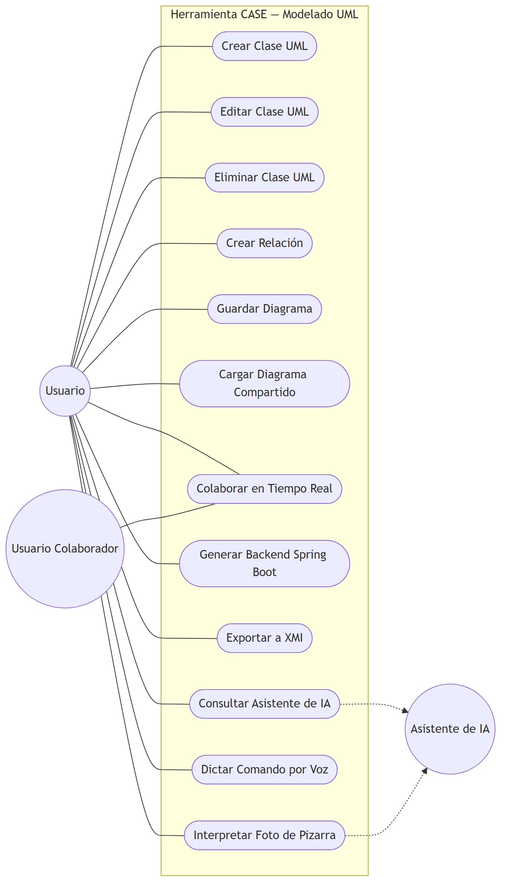{width="5.0in" height="8.78125in"}

*Figura 1. Diagrama General de Casos de Uso --- Vista completa del sistema*

# 3. Análisis

## 3.1 Análisis De Arquitectura

### 3.1.1 Identificar Paquetes

El sistema se organiza en tres paquetes principales dentro del backend de la herramienta (diagrams, generator, ai), consumidos por dos módulos del frontend (el lienzo y el panel de chat). Cada paquete agrupa los casos de uso relacionados y define un subsistema con responsabilidades bien delimitadas.

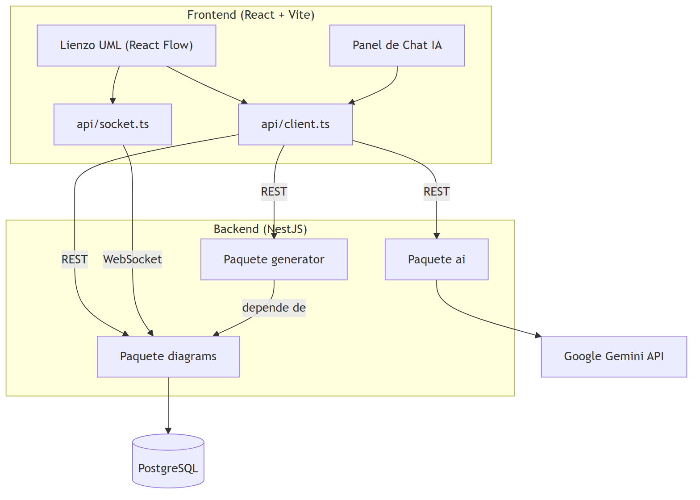{width="5.208333333333333in" height="3.71875in"}

*Figura 2. Diagrama de Paquetes del Sistema*

## 3.2. Análisis de caso de uso --- Diagramas de Comunicación

Los diagramas de comunicación muestran las interacciones entre objetos boundary (interfaz), control (lógica) y entity (datos) siguiendo el patrón ECB de PUDS. Los mensajes están numerados para indicar el orden de las interacciones.

***CU1 --- Crear Clase UML***

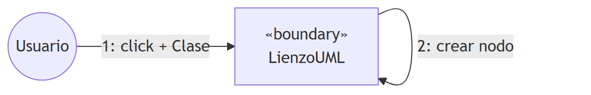{width="5.0in" height="0.8125in"}

*Figura --- Diagrama de Comunicación CU1*

***CU2 --- Editar Clase UML***

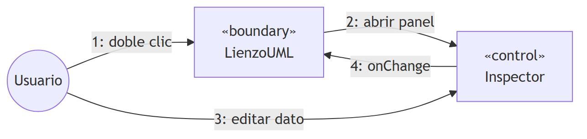{width="5.0in" height="1.1875in"}

*Figura --- Diagrama de Comunicación CU2*

***CU3 --- Eliminar Clase UML***

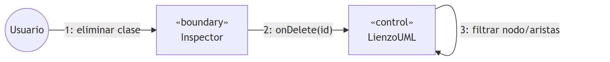{width="5.0in" height="0.5104166666666666in"}

*Figura --- Diagrama de Comunicación CU3*

***CU4 --- Crear Relación entre Clases***

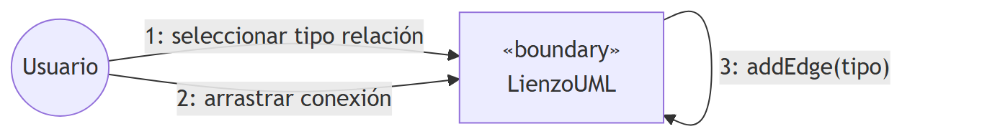{width="5.0in" height="0.6979166666666666in"}

*Figura --- Diagrama de Comunicación CU4*

***CU5 --- Guardar Diagrama***

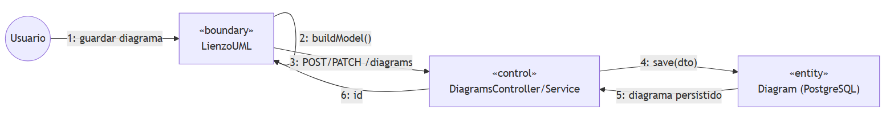{width="5.0in" height="0.6458333333333334in"}

*Figura --- Diagrama de Comunicación CU5*

***CU6 --- Cargar Diagrama Compartido***

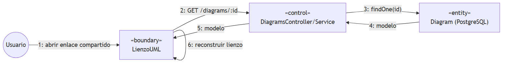{width="5.0in" height="0.6354166666666666in"}

*Figura --- Diagrama de Comunicación CU6*

***CU7 --- Colaborar en Tiempo Real***

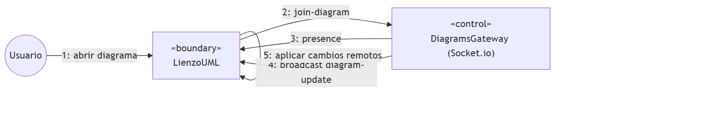{width="5.0in" height="0.8333333333333334in"}

*Figura --- Diagrama de Comunicación CU7*

***CU8 --- Generar Backend Spring Boot***

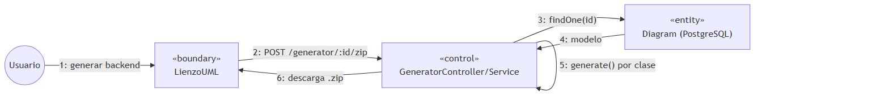{width="5.0in" height="0.5520833333333334in"}

*Figura --- Diagrama de Comunicación CU8*

***CU9 --- Exportar Diagrama a XMI***

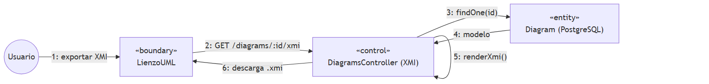{width="5.0in" height="0.6041666666666666in"}

*Figura --- Diagrama de Comunicación CU9*

***CU10 --- Consultar Asistente de IA***

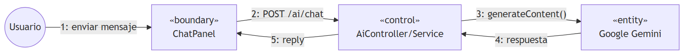{width="5.0in" height="0.4166666666666667in"}

*Figura --- Diagrama de Comunicación CU10*

***CU11 --- Dictar Comando por Voz***

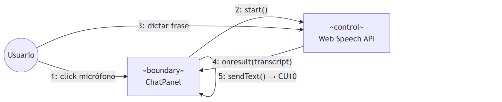{width="5.0in" height="1.0208333333333333in"}

*Figura --- Diagrama de Comunicación CU11*

***CU12 --- Interpretar Foto de Pizarra***

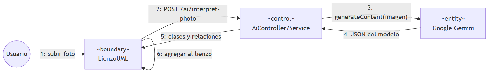{width="5.0in" height="0.7604166666666666in"}

*Figura --- Diagrama de Comunicación CU12*

## 3.3. Análisis de clase

Las clases de análisis siguen el patrón ECB: clases boundary (interfaz con el usuario), control (lógica de negocio) y entity (datos persistentes).

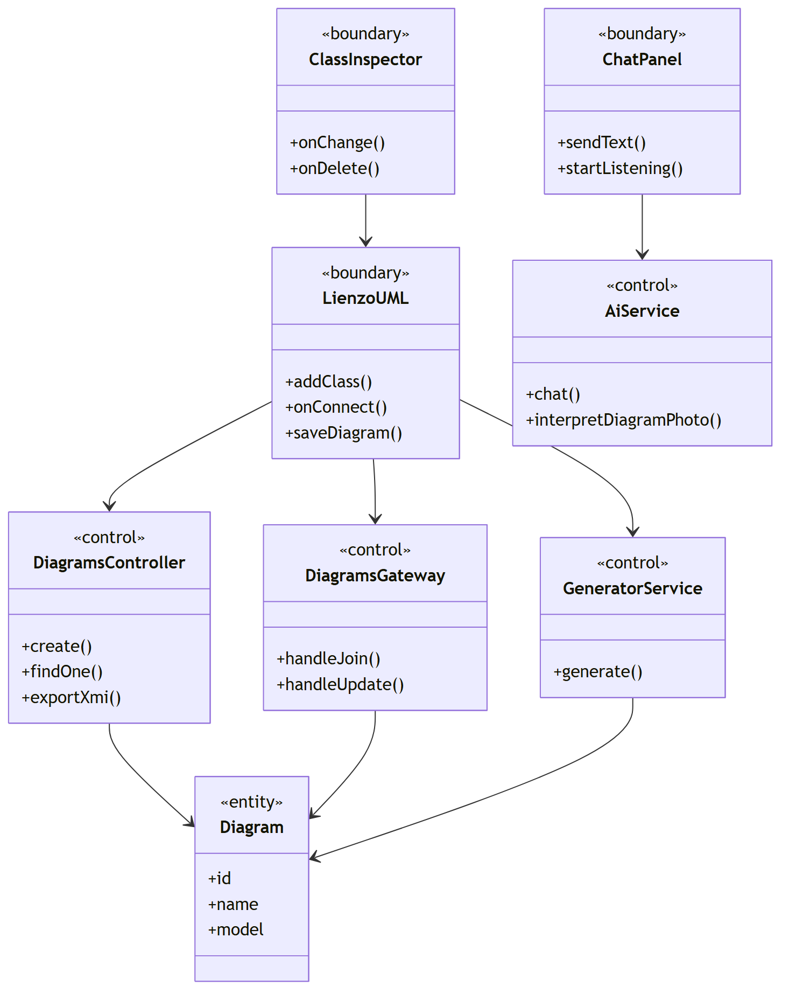{width="5.0in" height="6.333333333333333in"}

*Figura 15. Clases de Análisis --- Patrón Boundary-Control-Entity del sistema*

## 3.4. Análisis de paquete

El diagrama de paquetes (Figura 2) organiza la arquitectura lógica en tres paquetes de backend con dependencias unidireccionales que minimizan el acoplamiento: el paquete generator depende del paquete diagrams para obtener el modelo a transformar, mientras que el paquete ai es independiente y solo depende del proveedor externo de IA.

# 4. Diseño

## 4.1 Diseño de arquitectura

### 4.1.1 Diseño físico de arquitectura (Diagrama de Despliegue)

El sistema se despliega como dos servicios independientes: el frontend (aplicación React servida al navegador) y el backend (Node.js/NestJS), con PostgreSQL como servidor de base de datos y Google Gemini como servicio de IA en la nube.

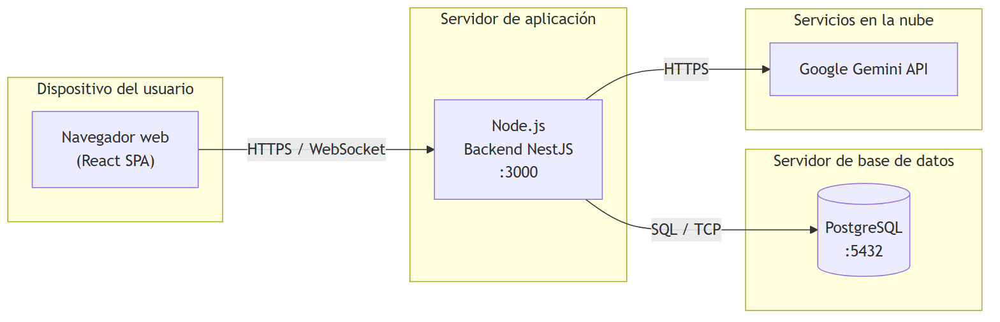{width="5.208333333333333in" height="1.6770833333333333in"}

*Figura 16. Diagrama de Despliegue del Sistema*

### 4.1.2 Diseño lógico de arquitectura

La arquitectura lógica sigue el patrón de tres capas: Presentación (React SPA), Lógica de Negocio (NestJS: diagrams, generator, ai) y Persistencia (PostgreSQL). El frontend se comunica con el backend mediante HTTP REST y WebSockets (ver Figura 2).

## 4.2 Diseño de datos lógicos

El modelo de datos de la herramienta utiliza PostgreSQL. La entidad principal es:

- **Diagram:** id (UUID), name (String), model (JSONB --- contiene las clases con sus atributos y posiciones, y las relaciones entre ellas), createdAt, updatedAt.

Se optó deliberadamente por una única entidad con un campo JSONB para el modelo UML, en lugar de tablas normalizadas por clase/atributo/relación: el modelo UML del usuario es un documento auto-contenido que se lee y escribe siempre completo (no se consulta una clase individual fuera de su diagrama), por lo que JSONB ofrece flexibilidad de esquema sin sacrificar las garantías transaccionales de PostgreSQL.

## 4.3 Diseño de casos de uso

### 4.3.1 Diagrama de secuencia

Los diagramas de secuencia especifican el comportamiento dinámico de cada caso de uso mostrando el intercambio de mensajes entre los componentes reales del sistema (frontend, controladores NestJS, servicios, base de datos y la API de Gemini) en orden cronológico.

***CU1 --- Crear Clase UML***

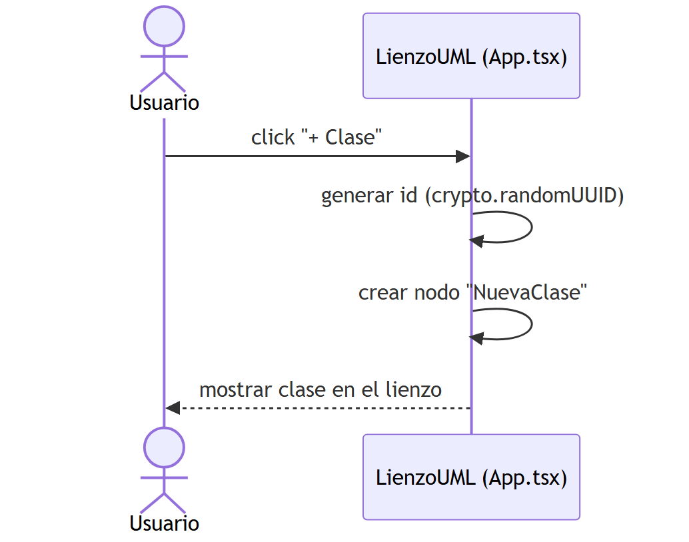{width="5.208333333333333in" height="4.104166666666667in"}

*Figura --- Diagrama de Secuencia CU1*

***CU2 --- Editar Clase UML***

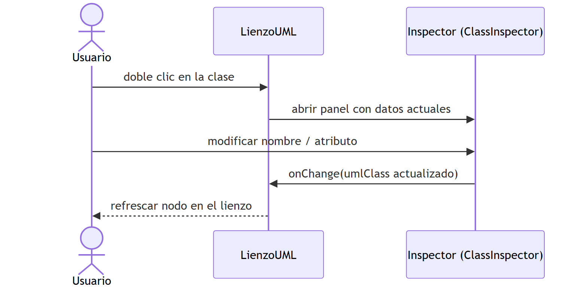{width="5.208333333333333in" height="2.5729166666666665in"}

*Figura --- Diagrama de Secuencia CU2*

***CU3 --- Eliminar Clase UML***

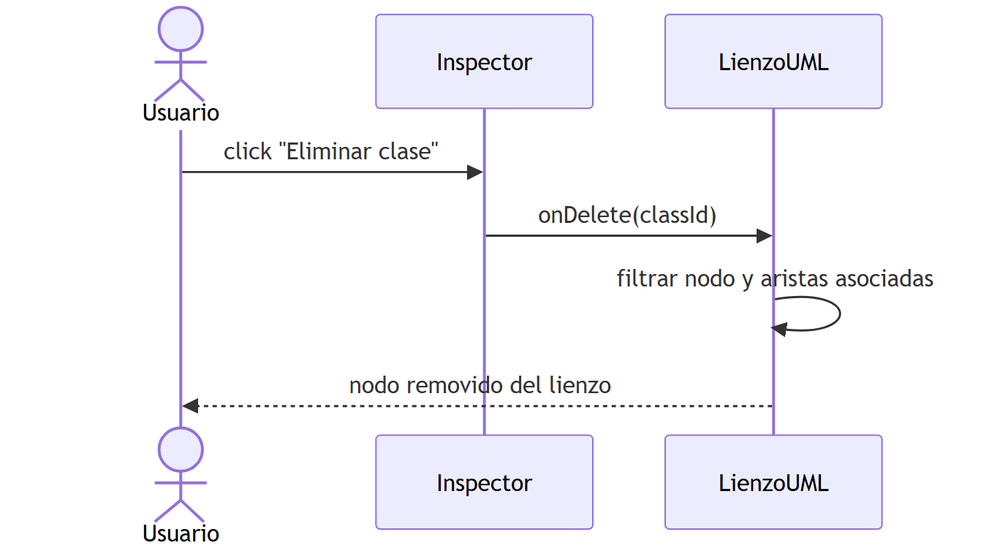{width="5.208333333333333in" height="2.875in"}

*Figura --- Diagrama de Secuencia CU3*

***CU4 --- Crear Relación entre Clases***

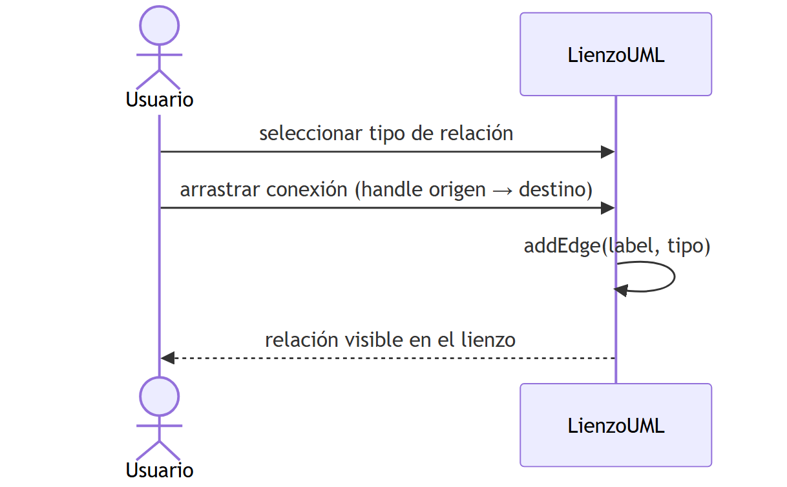{width="5.208333333333333in" height="3.2291666666666665in"}

*Figura --- Diagrama de Secuencia CU4*

***CU5 --- Guardar Diagrama***

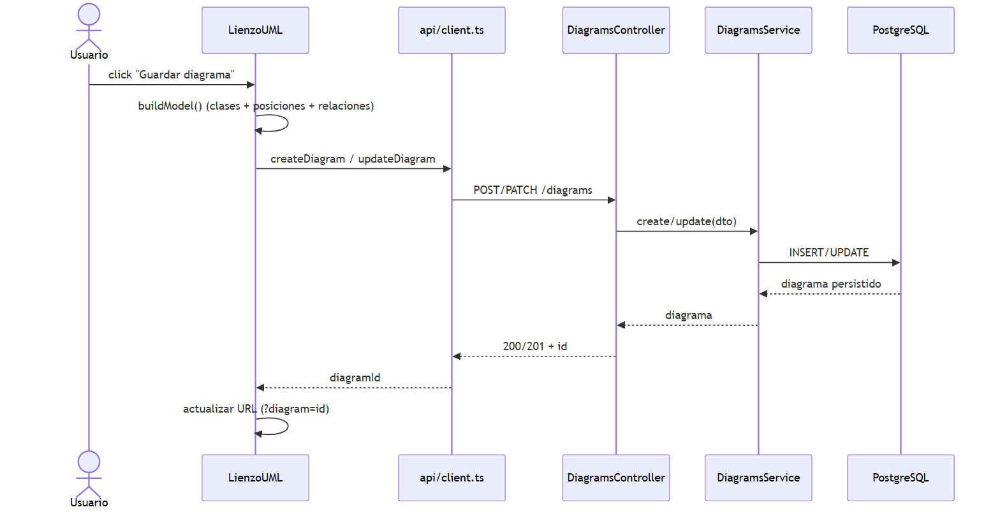{width="5.208333333333333in" height="2.6770833333333335in"}

*Figura --- Diagrama de Secuencia CU5*

***CU6 --- Cargar Diagrama Compartido***

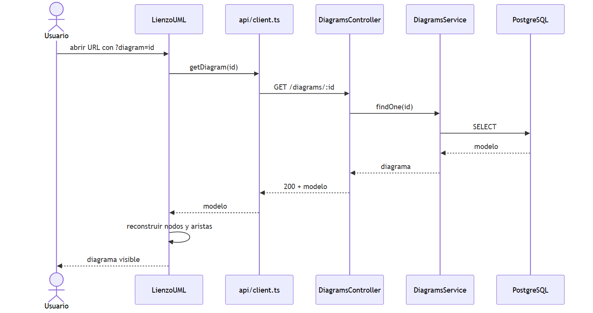{width="5.208333333333333in" height="2.75in"}

*Figura --- Diagrama de Secuencia CU6*

***CU7 --- Colaborar en Tiempo Real***

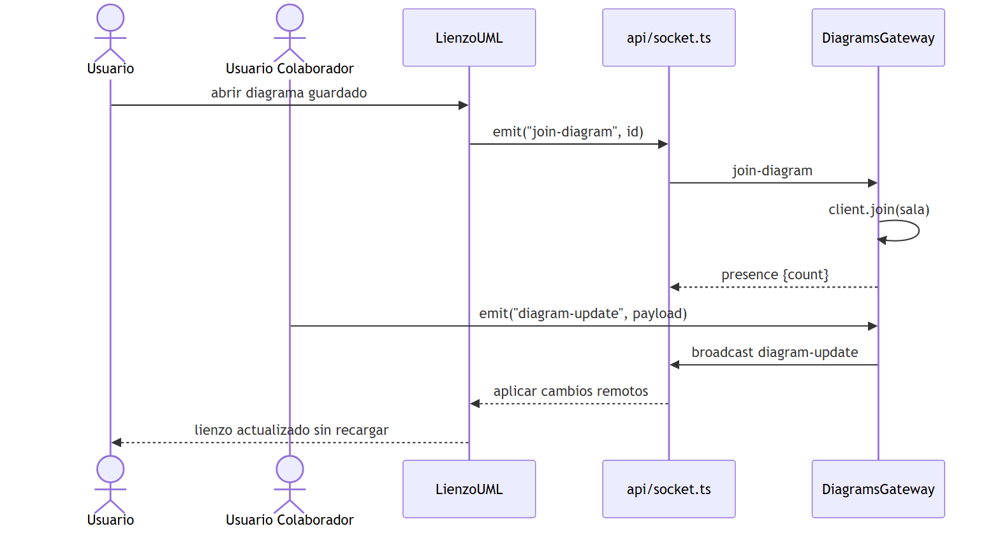{width="5.208333333333333in" height="2.78125in"}

*Figura --- Diagrama de Secuencia CU7*

***CU8 --- Generar Backend Spring Boot***

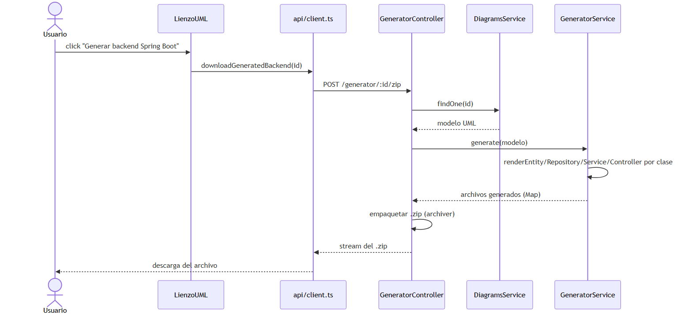{width="5.208333333333333in" height="2.3958333333333335in"}

*Figura --- Diagrama de Secuencia CU8*

***CU9 --- Exportar Diagrama a XMI***

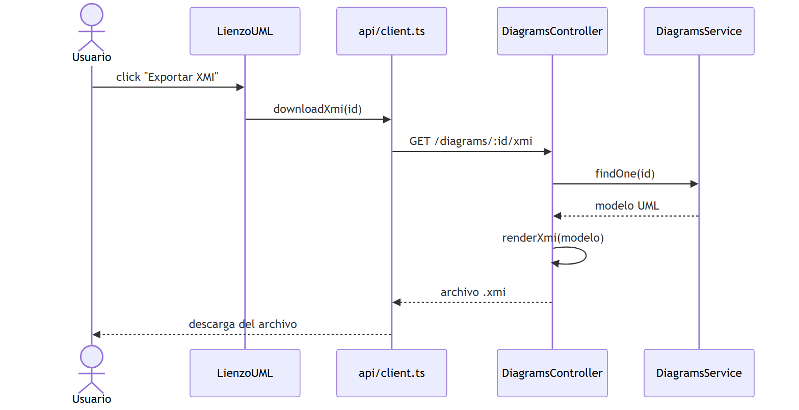{width="4.7774409448818895in" height="2.4556036745406824in"}

*Figura --- Diagrama de Secuencia CU9*

***CU10 --- Consultar Asistente de IA***

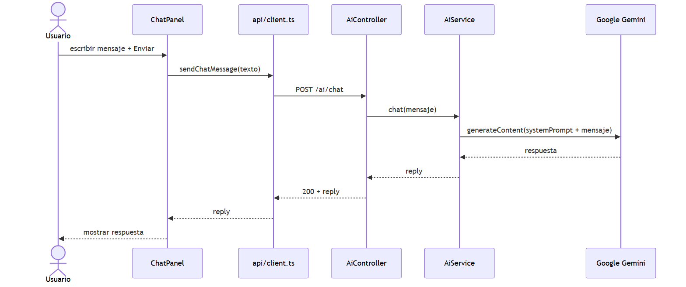{width="5.208333333333333in" height="2.1875in"}

*Figura --- Diagrama de Secuencia CU10*

***CU11 --- Dictar Comando por Voz***

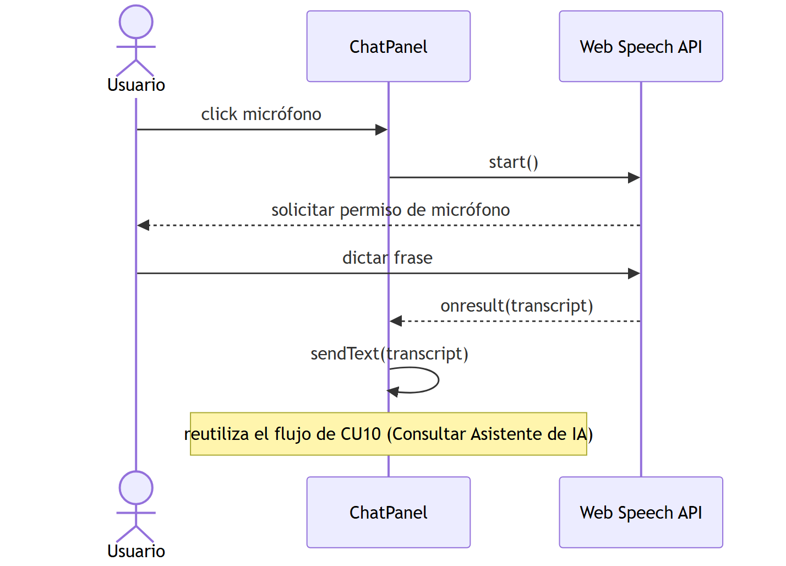{width="5.208333333333333in" height="3.75in"}

*Figura --- Diagrama de Secuencia CU11*

***CU12 --- Interpretar Foto de Pizarra***

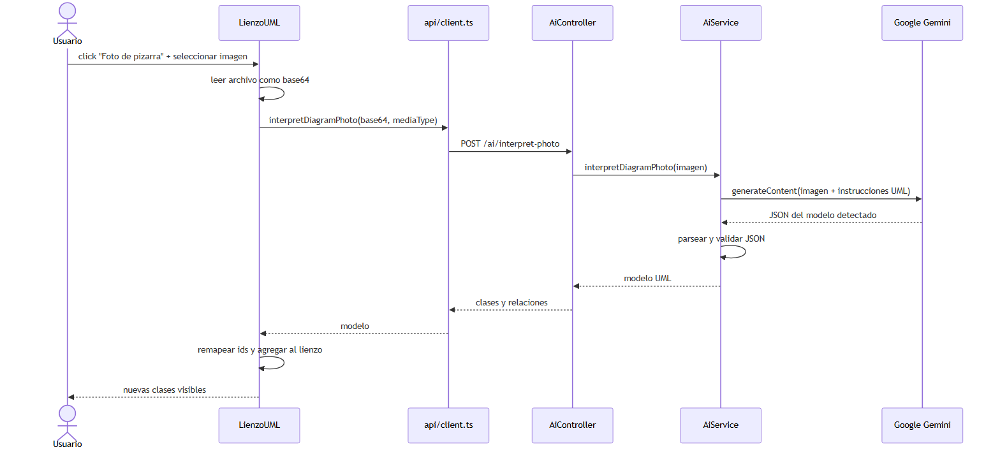{width="5.208333333333333in" height="2.3645833333333335in"}

*Figura --- Diagrama de Secuencia CU12*

# 5. Implementación

## 5.1 Implementación de la arquitectura del sistema

El sistema está implementado con una arquitectura de dos servicios independientes:

- **Frontend --- React + Vite:** SPA con el lienzo de diagramación (React Flow), colaboración vía Socket.io-client, y el panel de chat de IA con reconocimiento de voz nativo del navegador.

- **Backend --- NestJS:** API REST con TypeORM sobre PostgreSQL, gateway de WebSockets (Socket.io) para colaboración, y el motor generador de código Spring Boot.

## 5.2 Implementación de la arquitectura de subsistema

### 1. Backend de la herramienta --- NestJS

Arquitectura modular por dominio (diagrams, generator, ai), cada uno con su Controller → Service, y el módulo diagrams además con su Gateway de WebSockets y su entidad TypeORM.

### 2. Motor generador --- Plantillas Java parametrizadas

Por cada clase del diagrama, el generador invoca las mismas cuatro funciones de plantilla (renderEntity, renderRepository, renderService, renderController), resolviendo las relaciones JPA mediante un módulo dedicado (relations.util.ts) que determina el lado propietario y el lado inverso de cada asociación.

### 3. Colaboración en Tiempo Real --- Socket.io

El backend usa un Gateway de WebSockets. Los usuarios se unen a una sala identificada por el id del diagrama (evento join-diagram) y reciben los cambios de los demás participantes (evento diagram-update), además de un contador de presencia en tiempo real.

### 4. Inteligencia Artificial --- Google Gemini

El backend invoca directamente el SDK de Google Gemini (sin microservicio intermedio) con instrucciones de sistema distintas según la tarea: una para el chat conversacional enjaulado a ingeniería de software, y otra para la interpretación de imágenes que enseña al modelo a leer la notación UML dibujada a mano y a devolver JSON estructurado.

# 6. Pruebas

Esta fase valida que la implementación cumpla los requisitos definidos en el Perfil y el Modelo de Casos de Uso. A diferencia del resto de este documento, aquí no se describe lo que el sistema debería hacer, sino la evidencia concreta de que se verificó que lo hace.

## 6.1 Plan de pruebas

- **Alcance:** pruebas unitarias sobre la lógica pura del backend (el algoritmo de diff de la bitácora), pruebas funcionales del backend generado (Spring Boot) con Postman, y pruebas de integración y de sistema ejecutadas en vivo contra los servicios reales (PostgreSQL, Amazon S3, Google Gemini) y, para el sistema completo, contra el servidor de producción real en AWS (http://34.231.176.225), no contra localhost.

- **Estrategia:** caja blanca (Vitest) para la lógica de negocio aislable, y caja negra (peticiones HTTP reales vía curl/Postman y verificación desde el navegador) para los endpoints REST, los WebSockets y el flujo end-to-end del usuario.

- **Criterios de aceptación:** el código Spring Boot generado debe compilar y ejecutarse sin modificaciones; cada endpoint debe responder con el código HTTP y el cuerpo esperado; un archivo subido a S3 debe descargarse con el mismo contenido byte a byte que el original.

## 6.2 Diseño de pruebas (casos de prueba)

- **CP-01 --- Generación de backend Spring Boot:** a partir de un diagrama con relaciones 1:1, 1:N y N:N, el backend generado debe incluir las cuatro capas (Entity, Repository, Service, Controller) por clase, con las anotaciones JPA correctas (@OneToMany/@ManyToOne, tabla intermedia para N:N).

- **CP-02 --- Autenticación y bitácora:** registrar un usuario, iniciar sesión, crear y modificar un diagrama, y verificar que la bitácora registre el nombre real del usuario autenticado y un resumen legible del cambio (clases agregadas, atributos modificados, relaciones eliminadas).

- **CP-03 --- Adjuntos en S3:** subir un archivo permitido y verificar que aparece en el listado del diagrama, descargarlo mediante la URL firmada y comparar el contenido con el original, eliminarlo y confirmar que desaparece del bucket, e intentar subir un archivo de tipo no permitido (.exe) y verificar el rechazo.

- **CP-04 --- Colaboración en tiempo real:** con dos sesiones de navegador abiertas sobre el mismo diagrama, verificar que un cambio hecho en una se refleje en la otra vía WebSocket sin recargar la página.

- **Componente de prueba:** la suite model-diff.util.spec.ts (Vitest) ejercita la función pura summarizeModelDiff con 7 casos --- clase agregada, eliminada, renombrada, atributos y operaciones modificados, y relaciones agregadas/eliminadas/con tipo cambiado --- sin depender de base de datos ni red.

## 6.3 Pruebas de integración

- **Frontend ↔ Backend (vía Nginx):** en producción, Nginx actúa como proxy reverso hacia NestJS para /auth, /diagrams, /attachments, /generator, /ai y /socket.io. Se verificó cada ruta con peticiones reales contra la IP pública.

- **Backend ↔ PostgreSQL:** persistencia de diagramas, relaciones y entradas de la bitácora, con DB_SYNCHRONIZE=true generando el esquema automáticamente al iniciar el contenedor.

- **Backend ↔ Amazon S3:** subida, descarga con URL firmada (expira en 5 minutos) y eliminación, verificadas contra el bucket real diagramador-uml-adjuntos-fernando, no contra un mock.

- **Backend ↔ Google Gemini:** el chat conversacional, el dictado por voz y la interpretación de fotografías de diagramas dibujados a mano se probaron contra el servicio real de IA, no contra una respuesta simulada.

Defectos encontrados y corregidos durante la integración (antes del primer despliegue a producción, gracias a un ensayo local completo con Docker Compose sobre la misma imagen que se desplegaría):

- **Rutas de Nginx incompletas:** nginx.conf no reenviaba /auth ni /attachments al backend --- se habían agregado esos módulos después de escribir la configuración original. Sin el fix, login y adjuntos habrían devuelto el HTML de la SPA en vez de JSON en producción, aunque funcionaran en desarrollo.

- **Incompatibilidad de versión de Node/npm en el build:** node:22-alpine (npm 10.x) resolvía package-lock.json de forma distinta al npm 11.x local, y npm ci fallaba dentro del contenedor con "Missing: typescript@5.9.3 from lock file". Se corrigió alineando ambos Dockerfiles a node:24-alpine.

- **Variables de entorno incompletas en Docker Compose:** docker-compose.prod.yml no exponía JWT_SECRET ni las variables AWS\_\* al contenedor del backend --- se agregaron esas variables después de escribir el archivo original.

## 6.4 Pruebas de sistema

Se ejecutó el flujo completo extremo a extremo contra el servidor de producción real (http://34.231.176.225), no contra un entorno local:

- **SYS-01 --- Registro, autenticación y creación de diagrama:** un usuario nuevo se registra, inicia sesión, crea un diagrama y agrega clases --- resultado: correcto.

- **SYS-02 --- Bitácora de cambios:** cada modificación queda registrada con el nombre real del usuario y un resumen del cambio --- resultado: correcto.

- **SYS-03 --- Documentos adjuntos:** subida a S3 real desde dentro de la infraestructura de AWS --- resultado: correcto.

- **SYS-04 --- Generación de backend Spring Boot:** descarga del proyecto generado, revisión de las cuatro capas por clase --- resultado: correcto.

- **SYS-05 --- Recuperación ante reinicio del servidor:** los tres contenedores (restart: unless-stopped, Docker habilitado al arranque) vuelven a levantarse automáticamente tras un reinicio de la instancia EC2, sin intervención manual.

## 6.5 Evaluación de las pruebas

Todos los casos de prueba diseñados en 6.2 se ejecutaron y pasaron. Los tres defectos encontrados durante la integración (6.3) se detectaron antes de tocar la infraestructura de AWS ---gracias a ensayar primero la pila completa de Docker Compose en local--- y se corrigieron y verificaron antes del primer despliegue real, por lo que ninguno llegó a afectar al sistema en producción. Se considera que el sistema cumple los criterios de aceptación definidos en el plan de pruebas y está listo para la fase de despliegue documentada en la Parte I, sección 3.

**PARTE 3 --- Mecanismo para que el Usuario Utilice la Aplicación**

# 3.1. Un agente asistente del software

El mecanismo principal mediante el cual el usuario interactúa con la aplicación no se limita al lienzo de arrastrar y soltar: la herramienta incorpora un agente asistente de IA, visible como un panel de chat permanente junto al lienzo, que acompaña al usuario durante todo el proceso de modelado.

Este agente cumple tres funciones como mecanismo de uso:

- **Guía conversacional:** el usuario puede preguntarle sobre modelado UML, normalización o arquitectura en capas, y el agente responde dentro de ese dominio, sin desviarse a temas ajenos al proyecto.

- **Canal de entrada alternativo a dibujar:** en lugar de arrastrar manualmente cada clase, el usuario puede dictar por voz un comando (\"crea dos clases relacionadas\") o mostrarle una fotografía de un diagrama ya dibujado en una pizarra o cuaderno, y el agente traduce esa entrada ---hablada o visual--- directamente en clases y relaciones sobre el lienzo.

- **Reducción de la barrera de entrada:** un usuario sin experiencia formal en UML puede describir su necesidad en lenguaje natural y obtener un primer borrador del modelo, que luego refina manualmente en el lienzo.

De esta forma, el agente asistente no es una función aislada, sino el mecanismo transversal que conecta los tres canales de entrada del sistema ---dibujo manual, voz y fotografía--- en una sola experiencia de modelado.

# 3.2. Manual de Usuario

Esta sección describe, paso a paso, el uso funcional de la herramienta desde la perspectiva del usuario final: cómo acceder, modelar un diagrama de clases, validarlo, generar el backend Spring Boot correspondiente, exportarlo a XMI y apoyarse en el asistente de IA descrito en la sección 3.1.

### 3.2.1 Acceso a la herramienta

La aplicación es accesible desde cualquier navegador web moderno en la dirección del servidor donde esté desplegada. A diferencia de un sistema empresarial con roles diferenciados, el lienzo no requiere registro ni inicio de sesión: cualquier persona con el enlace puede abrir la herramienta y comenzar a modelar de inmediato. Para trabajo colaborativo, el enlace de un diagrama específico (generado al guardarlo por primera vez) es lo que se comparte entre los miembros del equipo.

### 3.2.2 Modelado del diagrama de clases

El lienzo central permite construir el diagrama de clases de forma completamente visual, sin escribir código:

- **Crear una clase:** el botón "+ Clase" agrega un nuevo nodo UML al lienzo con un atributo "id" marcado como clave primaria por defecto.

- **Editar una clase:** un clic sobre el nodo abre el panel inspector, donde se renombra la clase y se agregan, editan o eliminan atributos (nombre, tipo de dato, visibilidad y si es clave primaria).

- **Crear una relación:** se elige el tipo de relación (asociación, agregación, composición, herencia, uno a uno, uno a muchos, muchos a uno o muchos a muchos) en el selector de la barra de herramientas y luego se arrastra desde el borde de una clase hasta otra; la etiqueta del tipo elegido queda visible sobre la línea de conexión.

### 3.2.3 Validación lógica del modelo

Antes de generar código, el botón " Validar diagrama" ejecuta un análisis automático del modelo sobre tres frentes: integridad estructural (clases sin clave primaria, nombres o atributos duplicados, relaciones que apuntan a una clase inexistente), redundancia por desnormalización según la Tercera Forma Normal (atributos que copian datos de una clase ya relacionada) y claves foráneas manuales redundantes (atributos tipo "clienteId" cuando la relación ya genera esa clave automáticamente). Los resultados se muestran en un panel lateral, separando errores ---que impiden un modelo relacional correcto--- de advertencias de buenas prácticas.

### 3.2.4 Guardado, colaboración y recorrido guiado

- **Guardar el diagrama:** el botón "Guardar diagrama" persiste el modelo actual y, en el primer guardado, asigna un identificador único que queda reflejado en la URL del navegador.

- **Colaborar en tiempo real:** el botón " Copiar enlace" genera una URL compartible; cada persona que la abre se une a la misma sesión sobre WebSockets, y los cambios de todos se propagan al instante entre los conectados, con un contador visible en la barra superior.

- **Recorrido guiado:** en la primera visita, un tour de siete pasos resalta cada control principal de la barra de herramientas; puede repetirse en cualquier momento con el botón "❓ Recorrido", útil tanto para nuevos usuarios como para una demostración en vivo.

### 3.2.5 Generación del backend y exportación a XMI

- **Generar backend Spring Boot:** descarga un proyecto Spring Boot completo en formato .zip, con arquitectura de cuatro capas (Entity, Repository, Service, Controller) generada a partir del diagrama, listo para importarse en un IDE Java y ejecutarse contra PostgreSQL.

- **Exportar a XMI:** descarga el diagrama en formato XMI 2.1 / UML 2.1, importable directamente en Enterprise Architect u otras herramientas UML estándar, para su uso fuera de la plataforma.

### 3.2.6 Uso del asistente de IA

El panel de chat, siempre visible junto al lienzo, admite tres canales de entrada descritos en la sección 3.1: texto libre, dictado por voz (icono de micrófono, vía Web Speech API) y una fotografía de un diagrama dibujado a mano (botón "📷 Foto de pizarra"), que el asistente interpreta y traduce en clases y relaciones agregadas automáticamente al lienzo.

### 3.2.7 Conexión con la aplicación móvil

Una vez generado y desplegado el backend, el usuario final lo conecta a una aplicación móvil desarrollada en Flutter. El proyecto incluye una plantilla reutilizable (flutter-template) con un cliente REST genérico cuyo endpoint y esquema de datos se configuran en tiempo de ejecución ---sin recompilar la app---, pensada para conectar en minutos cualquier backend generado por la herramienta durante una demostración en vivo.

# Anexos

## Anexo A. Evidencia del sistema en funcionamiento

La evidencia incluida en las secciones 4.3 y 5.2 de este documento corresponde al sistema en ejecución real, no a mockups: una captura del lienzo interactivo con clases y relaciones dibujadas por el usuario (incluyendo el indicador de colaboración en tiempo real), y la transcripción literal de una consulta real respondida por el asistente de IA durante una sesión de pruebas del sistema.

## Anexo B --- Estándar de Codificación

### 1. Introducción

El presente estándar define las convenciones, herramientas y prácticas aplicadas durante la construcción del proyecto, con el fin de garantizar un código legible, uniforme y mantenible a través de las distintas tecnologías que lo componen: el backend en TypeScript (NestJS), el frontend en TypeScript (React), el cliente móvil en Dart (Flutter) y el código Java (Spring Boot) producido por el motor generador. La adopción de un estándar común reduce los errores de transcripción, facilita el trabajo colaborativo y asegura la coherencia del producto final.

### 2. Estándares Internacionales Implementados

- **UML 2.5 (OMG):** notación estándar para el modelado de los diagramas de clases, base conceptual de toda la herramienta.

- **XMI 2.1 (OMG):** formato estándar de intercambio de modelos para la importación y exportación con herramientas externas como Enterprise Architect.

- **OpenAPI 3 / REST:** los endpoints generados siguen el estilo arquitectónico REST y se documentan con la especificación OpenAPI 3 (Swagger UI).

- **ISO/IEC 25010:** atributos de calidad (mantenibilidad, portabilidad y fiabilidad) tomados como referencia del producto software.

- **Convenciones de nomenclatura:** TypeScript y Dart en camelCase (variables/funciones) y PascalCase (clases, tipos, componentes); Java en PascalCase para clases y camelCase para métodos, según Spring Boot; tablas de base de datos en snake_case.

- **Arquitectura en capas:** el backend generado respeta el patrón Controlador → Servicio → Repositorio → Entidad.

### 3. Stack Tecnológico y Herramientas de Calidad

El backend de la herramienta CASE está construido en NestJS + TypeScript (modo strict) con TypeORM y PostgreSQL; el frontend en React + Vite + TypeScript con React Flow; el cliente móvil en Flutter/Dart; y la salida generada en Spring Boot 3.3.4 con Java 17 y Maven. El aseguramiento de la calidad se apoya en herramientas automáticas:

- **oxlint:** analizador estático (linter) del código TypeScript en backend y frontend, que detecta errores y malas prácticas antes de la ejecución.

- **Prettier:** formateador automático con configuración uniforme (comillas simples y coma final en estructuras multilínea), evitando diffs ruidosos.

- **TypeScript strict:** verificación estricta de tipos en tiempo de compilación en backend y frontend.

- **vitest:** pruebas unitarias y de integración del backend, con medición de cobertura y pruebas end-to-end.

- **flutter_lints y flutter analyze:** reglas de análisis estático oficiales para el código Dart del cliente móvil.

### 4. Configuración del Entorno de Desarrollo

- **Requisitos:** Node.js 22+, PostgreSQL en localhost:5432 y el SDK de Flutter.

- **Variables de entorno (.env, nunca versionadas):** credenciales de base de datos, GEMINI_API_KEY y AI_PROVIDER (para alternar entre IA en la nube y la IA local).

- **Comandos estandarizados:** npm run start:dev (desarrollo con recarga en caliente), npm run lint (oxlint), npm run format (Prettier), npm test y npm run test:cov (vitest), npm run test:e2e (end-to-end).

- **Formateo automático al guardar** habilitado en el editor, para mantener el estilo sin intervención manual.

### 5. Flujo de Trabajo y Métricas

- **Control de versiones con Git:** cada avance se registra en commits con mensajes descriptivos y prefijos convencionales (feat, fix, docs), trazando la evolución del proyecto.

- **Verificación previa a la integración:** antes de validar un cambio se ejecutan el linter (oxlint / flutter analyze), el formateador y las pruebas automatizadas.

- **Métricas de calidad:** suite de pruebas del backend en verde con cobertura medida; verificación estricta de tipos (TypeScript strict); y pruebas específicas del motor generador que validan el pom.xml y las plantillas producidas.

- **Revisión de código:** el conocimiento del código por parte de los autores se verifica en la defensa presencial de autoría.

### 6. Conclusión

La aplicación de este estándar ---soportado por herramientas automáticas de análisis estático, formateo, verificación de tipos y pruebas--- asegura un nivel de calidad consistente a pesar de combinar cuatro lenguajes y plataformas distintas. El estándar no es solo un conjunto de recomendaciones: está respaldado por herramientas que lo hacen cumplir de forma automática, reduciendo la deuda técnica y facilitando la mantenibilidad y evolución futura del sistema.

**Referencias**

Fowler, M. (2002). Patterns of enterprise application architecture. Addison-Wesley.

Google. (2024). Gemini API documentation. https://ai.google.dev/docs

Jacobson, I., Booch, G., & Rumbaugh, J. (1999). The unified software development process. Addison-Wesley.

Martin, R. C. (2017). Clean architecture: A craftsman\'s guide to software structure and design. Prentice Hall.

Object Management Group. (2017). OMG Unified Modeling Language (UML), versión 2.5.1. https://www.omg.org/spec/UML/2.5.1/

Pressman, R. S., & Maxim, B. R. (2015). Ingeniería de software: Un enfoque práctico (8.a ed.). McGraw-Hill.

Ries, E. (2011). The lean startup. Crown Business.

Rumbaugh, J., Jacobson, I., & Booch, G. (2005). The Unified Modeling Language reference manual (2.a ed.). Addison-Wesley.

Spring Framework Documentation. (2024). Spring Boot reference documentation. https://docs.spring.io/spring-boot/docs/current/reference/html/

Szyperski, C. (2002). Component software: Beyond object-oriented programming (2.a ed.). Addison-Wesley.
